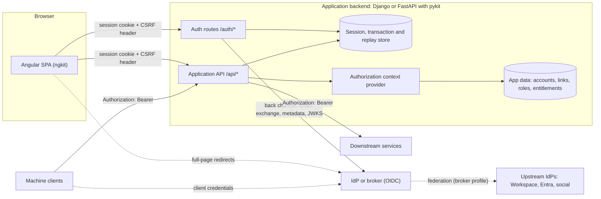
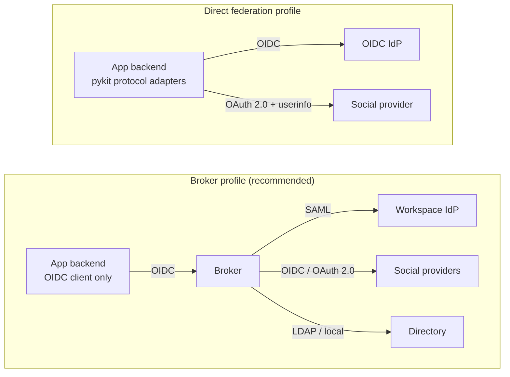
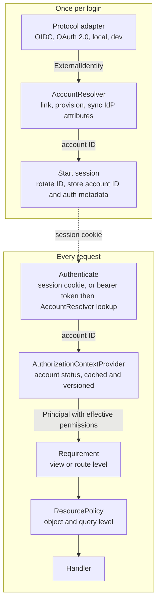
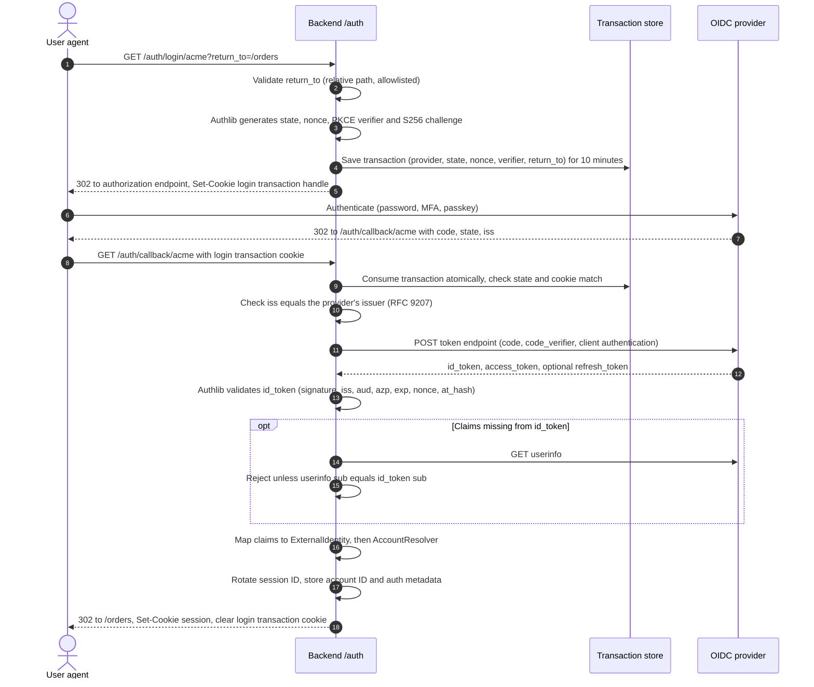
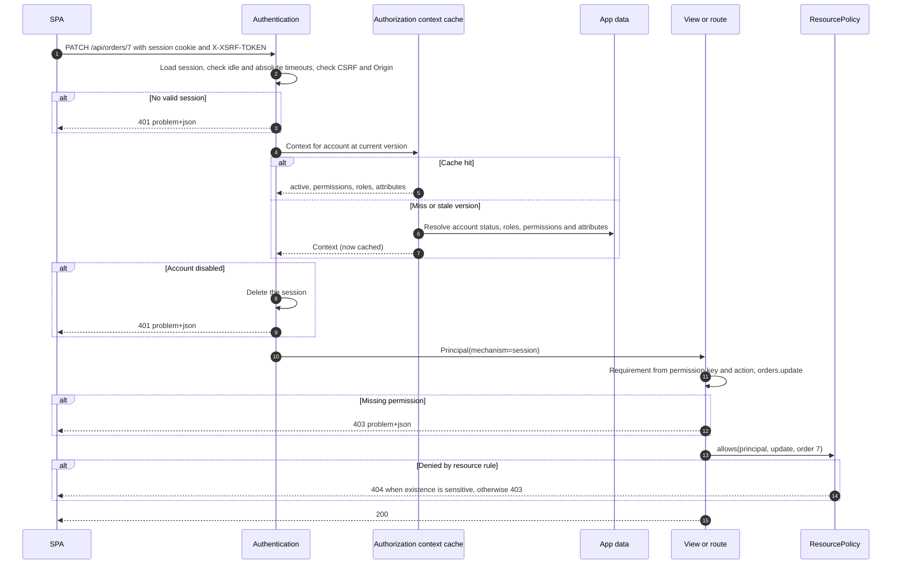
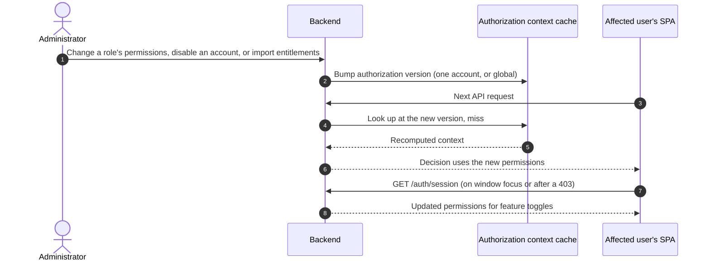
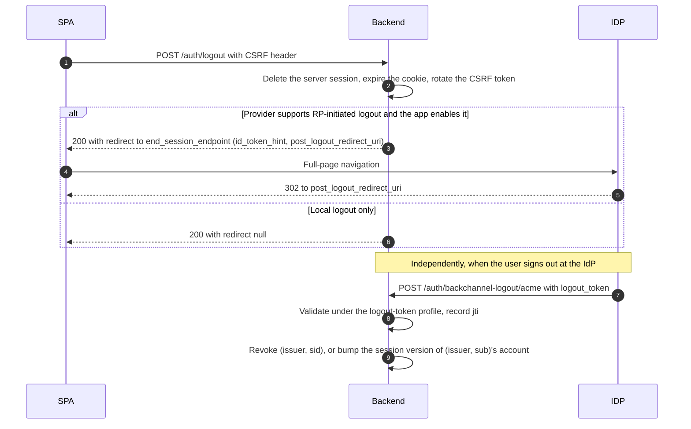
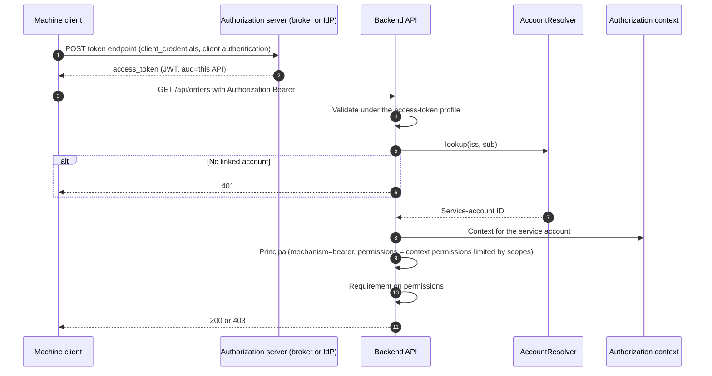
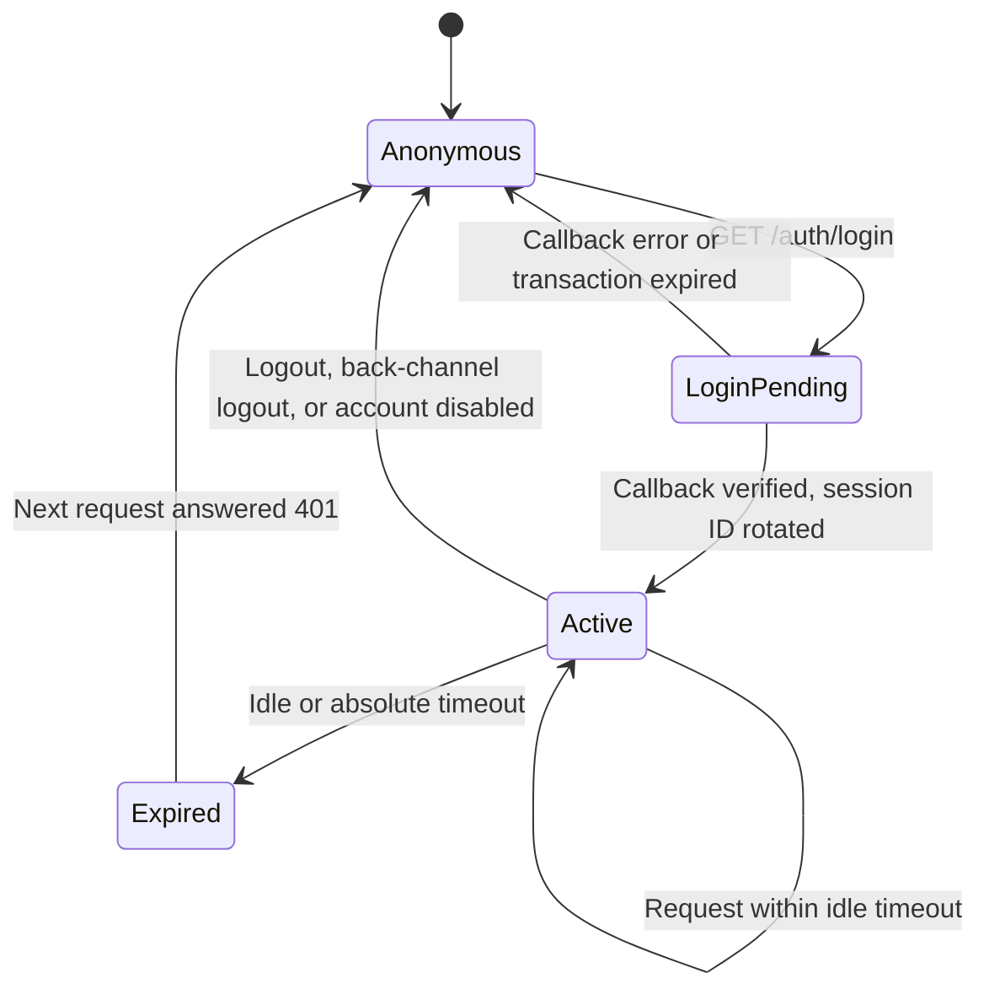
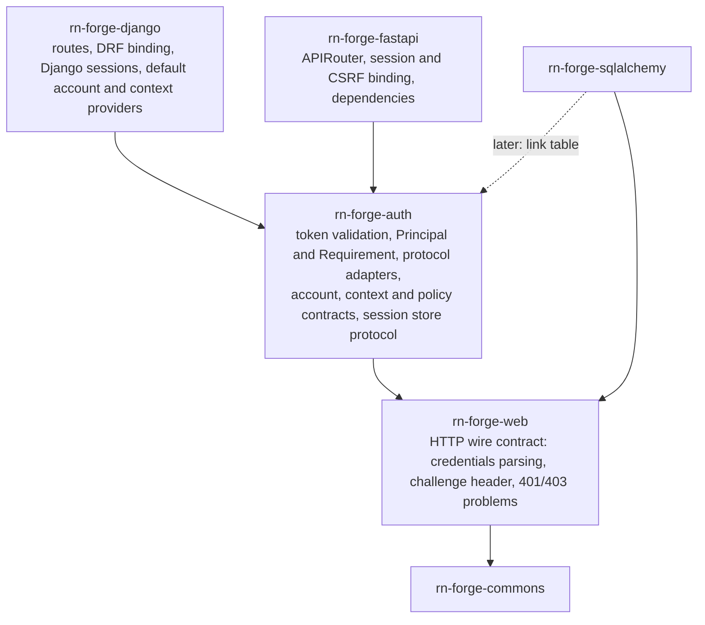

# E13 — Auth design

|  |  |
| -- | -- |
| **Epic** | [E13](index.md) |
| **Settled by** | [F13.1](F13.1-auth-design.md) |
| **Depends on** | [ADR-0001](../../../adr/ADR-0001.md), [ADR-0006](../../../adr/ADR-0006.md) |

How authentication and authorization work in a new rn-forge web application: a
pykit backend (Django or FastAPI) with an ngkit single-page app (SPA). This page
is a working proposal shared by every E13 feature. Nothing in it is decided
until it becomes an ADR or a feature. The owner has accepted its positions;
[F13.1](F13.1-auth-design.md) turns the
[proposed decisions](#proposed-decisions) into ADRs and records the
[library evaluation](#library-evaluation), which decided what pykit binds and
what it writes. [Auth patterns](patterns.md) explains the industry patterns this
design chooses from.

[Back to E13](index.md)

## Goals and non-goals

### Goals

1. One pattern for Django and FastAPI: the same HTTP surface, the same contracts
   and the same security controls. The underlying libraries may differ by
   framework; the behavior an application and the SPA see does not.
1. Single sign-on (SSO) through OpenID Connect (OIDC), with SAML 2.0 identity
   providers reached through a broker; social login through OIDC or OAuth 2.0;
   and optional local passwords.
1. Authorization that uses the application's own data (entitlements, org
   structure, tenancy) as well as what the identity provider (IdP) asserts.
1. An SPA that never handles tokens and still knows what to show the user.
1. Machine clients and downstream services that authenticate with standard
   bearer tokens.
1. Every flow testable offline: a development IdP and fake providers, with no
   switch that turns auth off.

### Non-goals

- pykit as an authorization server or token issuer
  ([ADR-0006](../../../adr/ADR-0006.md) stands).
- **SAML in pykit.** A SAML IdP federates through a broker that speaks OIDC to
  the app ([SAML identity providers](#saml-identity-providers)).
- Registration, password reset, MFA enrollment and account recovery. These
  belong to the IdP, or to Django's own auth for local accounts.
- A SCIM server, and integration with an external policy engine (OPA, Cedar,
  OpenFGA). The contracts leave room for both.
- **Passkeys and WebAuthn** as a local adapter. They come through the IdP or
  broker, and the app sees an ordinary OIDC login.
- **Magic links and email one-time codes.** Each adds enrollment, delivery and
  abuse handling that an IdP already owns.
- **ReBAC and policy engines** in the first version. RBAC plus ABAC through
  `ResourcePolicy` covers the target applications; an engine would sit behind
  the same contracts later.

## Principles

[Proposed decisions](#proposed-decisions) links each principle that became a
decision to its ADR.

1. **Federate, then forget the protocol.** Every login method (OIDC, OAuth 2.0
   social, local, development, and SAML through a broker) ends in the same
   `ExternalIdentity`. Nothing after that point knows which protocol ran.
1. **Browsers hold a session cookie, never tokens.** The backend is the
   browser's only party to the protocol (the backend-for-frontend, or BFF,
   pattern). Tokens and secrets stay on the server.
1. **External identity is resolved to an internal account before anything
   else.** A `sub` is unique only within its issuer. Session and bearer
   callers alike go from `(issuer, subject)` to an internal account ID, and
   only then to an authorization context.
1. **Identity at login; authorization per request.** The session records who the
   user is and how they signed in. What they may do is computed on the server
   for each request from current data, and cached with explicit invalidation.
1. **The UI mirrors authorization but never decides it.** The SPA reads the
   user's effective permissions from `/auth/session` to show or hide features.
   The server enforces every check again.
1. **pykit consumes tokens and never mints them.** Bearer tokens for machine
   clients and downstream services come from an authorization server.
1. **Proven libraries run the protocols; pykit owns the contracts and the safe
   defaults** ([ADR-0001](../../../adr/ADR-0001.md)). pykit writes a component
   only for a requirement an evaluated library cannot meet, and
   [Libraries](#libraries) records which requirement that is.

## Vocabulary

| Term | Meaning here |
| -- | -- |
| Identity provider (IdP) | The system that authenticates the user: Google Workspace, Entra ID, Okta, a social provider, or the app's local password store. |
| Broker | An IdP that federates to other IdPs and speaks one protocol to the app (Keycloak, Entra ID, Auth0, Zitadel, Authentik). |
| Relying party (RP) | The application backend in its OIDC role. |
| Login transaction | Server-side state for one login in flight: `state`, nonce, PKCE verifier, `return_to`. Consumed exactly once. |
| `ExternalIdentity` | The protocol-neutral result of a successful login: issuer, subject, verified profile claims, how and when the user authenticated. |
| Account | The application's record of a person or a service, with an internal ID, linked to one or more external identities. |
| Service account | An account for a machine client, linked to the `(issuer, subject)` its client-credentials tokens carry. |
| Session | Server-side state tied to an HttpOnly cookie. It holds an account ID and authentication metadata only. |
| Authorization context | Permissions, roles and attributes computed for an account from current application data. |
| Effective permissions | The permissions a request may use: the context's permissions, further limited by the token's scopes for a bearer caller. |
| `Principal` | The verified caller for one request: internal account ID, external identity, effective permissions and the authorization context. It is the same type for session and bearer callers. |
| Permission | A named capability the application grants to accounts (`orders.update`). |
| Scope | An OAuth capability delegated to a client by a token. It limits a token; it does not grant anything. |
| Requirement | A declarative check against a principal (`Requirement`). |
| Resource policy | A per-object and per-query check: may this principal do this action to this record, and which records may they list. |

## Layers

The design has three independent layers. Each hands the next one a single
contract, so any login method works with any way of carrying identity and any
authorization model, and swapping one layer changes only that layer's adapter
and configuration. [Auth patterns](patterns.md#the-three-layers) gives the
background.

| Layer | Ends in | Contract at the boundary |
| -- | -- | -- |
| Authentication | An internal account | `IdentityProvider` yields an `ExternalIdentity`; `AccountResolver` turns it, or a bearer token's `(issuer, subject)`, into an account |
| Session and token management | A verified caller | The session binding (account ID and authentication metadata), or `Authenticator` for bearer tokens |
| Authorization | Allow or deny | `AuthorizationContextProvider` builds the `Principal`; `Requirement` checks routes and `ResourcePolicy` checks records |

Sessions and tokens carry identity; they are not part of authorization.

## System context



The SPA and the API are served from **one origin**, with a reverse proxy routing
`/api` and `/auth` to the backend. Same-site is the minimum. This keeps the
session cookie first-party and lets Angular's built-in XSRF support work,
because Angular sends the XSRF header only to same-origin URLs.
[Deployment topology](#deployment-topology) covers setups that cannot do this.

## Deployment profiles

Both profiles share everything after the `ExternalIdentity`. They differ only in
how many protocols the backend speaks.



|  | Broker profile | Direct federation profile |
| -- | -- | -- |
| Backend speaks | OIDC only | OIDC, OAuth 2.0, local |
| Social providers set up | In the broker | In the app's provider configuration |
| SAML IdPs | Federated by the broker | Not supported: add a broker |
| Machine clients, mobile apps, several APIs | Supported: the broker issues tokens | Not supported without a broker, because pykit does not issue tokens |
| Operational cost | One more service to run, or a SaaS bill | None beyond the app |
| Choose when | More than one app or API, machine clients, native apps, or a SAML-only IdP | One backend, browser users only, IdPs that speak OIDC |

pykit supports both and treats the direct profile as a first-class option, not a
fallback. Many small applications have one backend and one SSO provider, and
they should not need Keycloak. Once a second API, a machine client or a
SAML-only IdP appears, the answer is a broker, not token issuance or SAML in
pykit.

## The pipeline



| Step | Contract | Provided by pykit | Written by the application |
| -- | -- | -- | -- |
| Protocol adapter (authentication) | `IdentityProvider` | OIDC, OAuth 2.0, local-password and development adapters over the [libraries](#libraries); transaction handling; `return_to` validation | Provider configuration; claim and attribute mapping when the defaults do not fit |
| Account resolution | `AccountResolver` | Default resolver with a link table: link on `(issuer, subject)`, provisioning policies, bearer lookup | Provisioning policy; the rules for syncing IdP attributes onto the account; service-account links |
| Session (session and token management) | framework binding | Session start and rotation, timeouts, CSRF, logout, revocation | Timeouts, if the defaults do not fit |
| Authorization context (authorization) | `AuthorizationContextProvider` | Caching, versioning, invalidation API; a default provider from Django groups and permissions | Where entitlements come from (HR master, tenant tables, role mappings); the scope-to-permission map |
| Requirement (authorization) | `Requirement` | Declarative permission checks; view action to permission key mapping | Permission keys on views and routes |
| Resource policy (authorization) | `ResourcePolicy` | Hooks in both frameworks for object checks and query scoping | Row-level rules |

## Contracts

This is a sketch of the framework-neutral types in `rn-forge-auth` (see
[Package placement](#package-placement)). The core modules are `identity`
(`ProviderKind`, `ExternalIdentity`, `LoginTransaction`, `LoginStart`,
`SessionInfo`, `IdentityProvider`), `accounts` (`AccountResolver`,
`AccountRejected`), `context` (`AuthorizationContext`,
`AuthorizationContextProvider`) and `policy` (`ResourcePolicy`), all
re-exported by `rn_forge.auth`.

```python
ProviderKind = Literal["oidc", "oauth2", "password", "development"]


@dataclass(frozen=True)
class LoginTransaction:
    id: str                       # opaque handle the transaction cookie carries
    provider: str
    return_to: str
    created_at: datetime
    state: str | None = None
    nonce: str | None = None
    code_verifier: str | None = None
    extra: Mapping[str, str] = field(default_factory=dict)  # provider-specific


@dataclass(frozen=True)
class LoginStart:
    transaction: LoginTransaction
    redirect_url: str | None      # None: the provider takes a form (password)


@dataclass(frozen=True)
class SessionInfo:                # the session content; identity only, no store
    account_id: str
    session_version: int
    provider: str
    issuer: str
    external_subject: str
    created_at: datetime
    expires_at: datetime          # absolute timeout
    auth_time: datetime | None = None
    amr: frozenset[str] = frozenset()
    session_ref: str | None = None
    id_token: str | None = None


@dataclass(frozen=True)
class ExternalIdentity:
    provider: str                 # configured provider id, e.g. "workspace"
    issuer: str                   # OIDC iss, or "local"
    subject: str                  # OIDC sub
    email: str | None = None
    email_verified: bool = False
    name: str | None = None
    picture: str | None = None
    groups: frozenset[str] = frozenset()
    attributes: Mapping[str, Any] = field(default_factory=dict)  # other mapped claims
    auth_time: datetime | None = None
    amr: frozenset[str] = frozenset()   # how the user authenticated (pwd, mfa, hwk)
    session_ref: str | None = None      # OIDC sid, for logout


class IdentityProvider[RequestT](Protocol):
    id: str
    kind: ProviderKind            # oidc | oauth2 | password | development

    def begin(self, request: RequestT, *, return_to: str) -> LoginStart:
        """Return the redirect (or form) and the LoginTransaction to persist."""

    def complete(
        self, request: RequestT, transaction: LoginTransaction
    ) -> ExternalIdentity:
        """Validate the IdP's response against the transaction."""

    def logout_redirect(
        self, session: SessionInfo, *, post_logout_redirect: str
    ) -> str | None:
        """Return the IdP's logout URL, or None for local logout only."""


class AccountRejected(AppException):
    reason: str                   # for logs; never rendered to the user


class AccountResolver(Protocol):
    def resolve(self, identity: ExternalIdentity) -> str:
        """Link, provision or reject a login; return the account ID.

        Raises AccountRejected.
        """

    def lookup(self, issuer: str, subject: str) -> str | None:
        """Return the account ID linked to a bearer token's issuer and subject.

        Never provisions.
        """


@dataclass(frozen=True)
class AuthorizationContext:
    active: bool
    session_version: int
    permissions: frozenset[str] = frozenset()
    roles: frozenset[str] = frozenset()
    attributes: Mapping[str, Any] = field(default_factory=dict)  # ABAC inputs


class AuthorizationContextProvider(Protocol):
    def resolve(self, account_id: str) -> AuthorizationContext: ...


class ResourcePolicy[ResourceT, QueryT](Protocol):
    def allows(self, principal: Principal, action: str, resource: ResourceT) -> bool: ...
    def scope(self, principal: Principal, action: str, query: QueryT) -> QueryT: ...
```

The neutral boundary is the login's result, not its request. A protocol handler
takes the framework's native request; what stays neutral is what comes out: an
`ExternalIdentity`, then the `Principal`, the authorization contracts and the
[session resource](#http-surface). Each login flow on each framework has exactly
one owner, either a library's integration or pykit's adapter over the library's
core, never both. No framework integration met the requirements, so pykit's
adapters own every flow on both frameworks
([Login flow owners](#login-flow-owners)).

`Principal` and `Requirement` move from `rn-forge-web` to `rn-forge-auth` and
change as follows. Each field keeps one provenance:

| `Principal` field | Holds | Source |
| -- | -- | -- |
| `subject` | Internal account or service-account ID | `AccountResolver` |
| `issuer`, `external_subject` | The external identity that authenticated | Session metadata, or the verified token |
| `mechanism` | `"session"`, `"bearer"` or `"basic"` | The authenticator |
| `scopes` | Delegated scopes; empty for a session | The verified token |
| `permissions` | Effective permissions | Authorization context, limited by scopes ([Authorization model](#authorization-model)) |
| `roles`, `attributes`, `tenant` | Application authorization data | Authorization context |
| `claims` | Verified token claims, for the application's own use; empty for a session | The verified token |
| `auth_time`, `amr` | How and when the caller authenticated | Session metadata, or the verified token |

- `Requirement` gains `any_permission` and `all_permissions`, checked against
  `Principal.permissions`, and loses its role clauses. Every protected action
  requires an effective permission: because scopes already limit effective
  permissions, no requirement can bypass a token's scopes, whereas a role
  check would pass an administrator's read-only token on a write route. Roles
  stay on the `Principal` as an input the context provider used and as a
  display hint. The scope clauses stay for a route that must name a scope
  directly; they can only narrow access further.
- The action-to-key mapping (`orders` + `partial_update` → `orders.update`),
  formerly in the Django mixins, is the neutral helper
  `requirement_for(permission_key, action, *, action_map=None)` in
  `rn_forge.auth.permissions`, beside `DEFAULT_PERMISSION_ACTION_MAP`; an
  explicit `action_map` merges over the default. Both frameworks use it.
- The scope limit is `effective_permissions(permissions, *, mechanism, scopes,
  scope_map)`: session and basic callers keep their account's permissions, and
  a bearer caller gets the intersection with the permissions its scopes map to.

## Libraries

Proven libraries run every protocol and cryptographic step. pykit adds the
contracts above, configuration with safe defaults, the transaction, replay and
session indexes, and the mapping to `ExternalIdentity`.

| Concern | Library | pykit's part |
| -- | -- | -- |
| OIDC and OAuth 2.0 client: authorization request, PKCE, token exchange, ID-token validation (signature, `iss`, `aud`, `azp`, `exp`, `iat`, `nonce`, `at_hash`), UserInfo | Authlib's core: its OAuth 2.0 client (`OAuth2Session`) and ID-token claims (`CodeIDToken`, over joserfc). Not its Django or Starlette integration. | The adapter that owns the flow on both frameworks: provider configuration, discovery with the issuer check, the login transaction, the `iss` response check (RFC 9207), the UserInfo `sub` check, claim mapping |
| Bearer access-token validation and the JWKS cache | PyJWT: `jwt.decode` and `PyJWKClient` | The [access-token profile](#token-validation): the required claims of each mode, the `typ` check, rejecting `nonce` and `events`, the algorithm allow-list, an HTTPS `jwks_uri` |
| Back-channel logout tokens | PyJWT, with the same `PyJWKClient` | The [logout-token profile](#token-validation)'s `typ`, `iat` window and `jti` replay checks |
| SAML 2.0 | None: pykit speaks no SAML | A SAML IdP federates through a broker ([SAML identity providers](#saml-identity-providers)) |
| Django sessions and CSRF | `django.contrib.sessions`, `CsrfViewMiddleware` | Cookie names and flags, timeouts, the session-version and revoked-`sid` checks on read |
| Django accounts and the link model | Django's auth models. django-allauth is not bound. | A default `AccountResolver` with an external-account link model unique on `(issuer, subject)`, and the provisioning policies of [Account linking](#account-linking). allauth links on its provider configuration ID and takes the subject from UserInfo unchecked. |
| FastAPI server-side sessions | None bound; redis-py for the Redis store | A session middleware over `SessionStore`. starsessions offers one expiry strategy (idle or absolute, not both), extends the session on every read, keeps the old record after rotation and has no read hook for the [revocation](#revocation) checks. |
| FastAPI CSRF | None bound | A synchronizer token kept in the server session, including the pre-session one ([CSRF](#csrf)). No evaluated library binds its token to the session. |
| Login transactions, replay records, revoked `sid` values | Django's Redis cache backend; redis-py on FastAPI | Atomic consume and set-if-absent ([Supported storage](#supported-storage)) |
| Password hashing | Django's hashers; an application-supplied verifier on FastAPI | Rate limiting and uniform failures |

Social login on Django uses the same adapters as on FastAPI.

[F13.2](F13.2-auth-package.md) moves only the code the evaluation keeps and
deletes what a library replaces, so the new package never publishes an API the
next feature removes. `TokenVerificationError` moves with the code it serves.

| Commons symbol | F13.2 | Reason |
| -- | -- | -- |
| `JwtVerifier` | Moves to `rn_forge.auth.oidc`, taking its keys from PyJWT's `PyJWKClient` | It becomes the access-token profile: PyJWT runs the checks, and the profile's restrictions are pykit's |
| `JwksCache` | Deleted, replaced by PyJWT's `PyJWKClient` | `PyJWKClient` caches the key set and refetches for an unknown `kid` at most once per `cooldown_duration` |
| `discover_oidc`, with `OidcConfiguration` | Moves | No library checks the discovery document's `issuer` against the configured issuer (RFC 8414 §3.3). The OIDC adapter passes its result to Authlib, and bearer configuration uses it for the `jwks_uri`. |
| `fetch_json`, with `FetchJson` | Moves, as `discover_oidc`'s transport only | It refuses plain HTTP except to a local host. `PyJWKClient` fetches key sets itself and accepts any HTTP URL, so configuration applies the same rule to the `jwks_uri`. |

### Library evaluation

S13.1.3 assessed each library on 2026-10-27 for fit, maintenance and the
requirements it leaves unmet. Each fit claim that only running code could settle
was spiked in a scratch directory on CPython 3.14.6, against an in-process fake
OIDC IdP and Redis 7.0. The spikes were not kept; this section records what they
showed. Advisories are PyPI's vulnerability data (OSV) for the latest version.

| Library | Version, release date | Python 3.14 | Typing under strict pyright | Open advisories | Result |
| -- | -- | -- | -- | -- | -- |
| Authlib | 1.9.1, 2026-10-14 | Classifier; installs and imports | No `py.typed`; typeshed's `types-authlib` (1.8 stubs) still leaves `OAuth.register` and the RFC 9068 validator partly unknown | None (eleven 2025–2026 advisories, all fixed by 1.6.12) | Core bound; integrations and RFC 9068 validator not bound |
| PyJWT | 2.15.1, 2026-09-28 | Classifier; installs and imports | `py.typed`, clean | None (about twenty 2026 advisories, fixed in 2.12 to 2.15; require 2.15 or later) | Bound |
| python3-saml | 1.16.0, 2023-10-09 | No classifier after 3.12; installs and imports with xmlsec 1.3.17 and lxml 6.1.3 | No `py.typed`; unknown types at every call | None | Not bound: SAML goes through a broker |
| django-allauth | 65.21.0, 2026-10-26 | Classifier; installs and imports | No `py.typed`; its models are unknown without Django stubs | None | Not bound |
| starsessions | 2.2.1, 2024-10-23 (2.3.0a1, 2026-03-16) | No classifier after 3.13; runs on 3.14 with Starlette 1.10 | `py.typed`, clean | None | Not bound |
| starlette-csrf | 3.0.0, 2023-06-27 | No classifier after 3.11; runs | `py.typed`; `CSRFMiddleware` is not re-exported | None | Not bound |
| fastapi-csrf-protect | 1.0.7, 2025-09-16 | Classifier; runs | `py.typed`, clean | None | Not bound |
| asgi-csrf | 0.11, 2024-11-15 | No classifiers; runs | No `py.typed` | None | Not bound |

starlette-session (0.4.3, 2022) and fastapi-sessions (0.3.2, 2021) pin Starlette
and FastAPI below 1.0 and were not spiked.

| Evaluated | For | Fits when | What the spike showed |
| -- | -- | -- | -- |
| Authlib's Django and Starlette integrations, against a pykit adapter over Authlib's core | The owner of the OIDC and OAuth 2.0 flows on each framework | The integration supports the transaction storage, `iss` check and UserInfo `sub` check above, and yields an `ExternalIdentity` | Both integrations fail alike. The transaction lives in the framework session (on Starlette's default signed-cookie session the PKCE verifier and nonce reach the browser), expires after an hour and is read, then deleted, not consumed atomically. A callback with a wrong `iss`, or none although discovery advertises `authorization_response_iss_parameter_supported`, completes. A UserInfo `sub` different from the ID token's is returned without error. A discovery document naming another issuer is accepted, and its issuer becomes the expected ID-token `iss`. The adapter over `OAuth2Session` and `CodeIDToken`, holding the transaction in Redis (`GETDEL`, 600-second TTL), rejected each of these, a replayed callback and another browser's callback, and returned the `ExternalIdentity` fields. **The adapter owns the flows.** |
| django-allauth (headless) | Django accounts, the link model, provisioning, social login and SAML (through python3-saml) | It serves [the HTTP surface](#http-surface) and session body, or a thin binding maps to them; it links on `(issuer, subject)`; its provisioning can follow [Account linking](#account-linking); back-channel logout and bearer lookup work alongside it | Its surface is its own: routes under `/_allauth/browser/v1/`, and a login that starts with a form `POST`. Its session body is `{status, data: {user, methods}, meta}`, with no permissions, roles or expiry. It links on `(provider configuration ID, uid)`: a second configuration for the same issuer treated the same subject as a new identity and started a sign-up. It takes `uid` from UserInfo: a UserInfo `sub` different from the ID token's started a sign-up for the UserInfo subject. It accepted a wrong `iss`, sent no nonce, and enables PKCE only when configured. It has no back-channel logout. Bearer lookup alongside it works, through an issuer-to-configuration map. **Not bound.** |
| starsessions | FastAPI sessions | It has a Redis store with per-session expiry, and a hook on read for the [revocation](#revocation) checks | The Redis store sets a TTL on each session record, and cookie flags allow `__Host-session`. It has no read hook; a middleware after its autoload middleware cleared a session with a bumped version or a revoked `sid`, deleted the record and expired the cookie. One expiry strategy applies to every session, rolling or fixed, so idle and absolute timeouts cannot both hold. With rolling expiry a `GET` reset the idle TTL to 1,800 seconds, so `/auth/session` would keep a session alive. `regenerate_session_id` left the old record readable. Its session handler is documented as private API. **Not bound.** |
| starlette-csrf, fastapi-csrf-protect, asgi-csrf | FastAPI CSRF | It provides a synchronizer token kept in the server session, or a signed token bound to it, plus pre-session tokens ([CSRF](#csrf)) | Each is a signed double-submit cookie with no tie to the session. A token pair minted in one browser was accepted with another browser's session cookie (`200` from all three). Each issues tokens before sign-in, unbound. fastapi-csrf-protect expects the unsigned token in the header while its cookie holds the signed one, which Angular's XSRF support cannot send. **None bound.** |
| Authlib's RFC 9068 validator, PyJWT's `PyJWKClient` | The access-token profile and the JWKS cache | It covers the [access-token profile](#token-validation), including a bound on refetches for an unknown `kid` | Authlib's validator accepted a token with no `typ` header, which RFC 9068 §4 forbids. It caches no keys (`get_jwks` ran once per token) and has no RFC 7519 mode and no algorithm allow-list. `jwt.decode` with the RFC 9068 required claims, plus pykit's `typ` check, accepted only the `at+jwt` token and rejected a missing `jti`, an ID-token-shaped token and an unknown `kid`. `PyJWKClient` with a 30-second `cooldown_duration` fetched once for 200 unknown `kid` values, rejected a newly rotated key during the cooldown and accepted it after. **PyJWT bound.** |
| python3-saml | The SAML service provider | It runs the SP checks under strict settings and takes the transaction's request ID | On 3.14 it loaded strict settings, built an `AuthnRequest` and exposed its ID, and rejected a forged response whose `InResponseTo` did not match. It has had no release since 2023-10; pysaml2 (7.5.5, 2026-09-17) is the maintained alternative. **Not bound:** the owner then moved SAML to the broker (2026-10-27), so pykit binds no SAML library. |

Authlib's `httpx` client warns that `httpx` is deprecated in favour of `httpx2`,
so the adapter uses the `requests`-based `OAuth2Session`, and the FastAPI
binding runs it in the thread pool. Strict pyright needs `types-authlib` in the
development group, and casts where the adapters call Authlib.

Both frameworks therefore share every protocol adapter. They differ only in
sessions and CSRF, where Django's built-ins meet the requirements and the
FastAPI binding uses pykit's own.

#### Login flow owners

| Flow | Django | FastAPI |
| -- | -- | -- |
| OIDC, including social and broker logins | pykit's OIDC adapter over Authlib's client | pykit's OIDC adapter over Authlib's client |
| OAuth 2.0-only social login | pykit's OAuth 2.0 adapter over Authlib's client | pykit's OAuth 2.0 adapter over Authlib's client |
| Local password | pykit's password adapter over Django's auth backends | pykit's password adapter over the application's verifier |
| Development | pykit's development adapter | pykit's development adapter |
| Back-channel logout | pykit's handler over PyJWT | pykit's handler over PyJWT |

## HTTP surface

Django and FastAPI mount the same routes. The prefix is configurable.
`{provider}` is a configured provider ID.

| Method | Path | Purpose | Response |
| -- | -- | -- | -- |
| `GET` | `/auth/providers` | Login options for the login page | `200` list of `{id, name, kind}` |
| `GET` | `/auth/login/{provider}?return_to=` | Start a login (full-page navigation, not XHR) | `302` to the IdP |
| `GET` | `/auth/callback/{provider}` | OIDC and OAuth 2.0 redirect URI | `302` to `return_to`, or to the error route |
| `GET` | `/auth/session` | Current user for the SPA; sets the CSRF cookie | `200` session body, or `401` problem |
| `POST` | `/auth/logout` | End this session (CSRF protected) | `200 {"redirect": url or null}` |
| `POST` | `/auth/logout/all` | End every session of this account (CSRF protected) | `200 {"redirect": null}` |
| `POST` | `/auth/backchannel-logout/{provider}` | OIDC Back-Channel Logout | `200` |
| `POST` | `/auth/login/password` | Local password login (optional provider) | `200` session body, or `401` |

`kind` is one of `oidc`, `oauth2`, `password` and `development`. The SPA
navigates to every kind except `password`, for which it shows a form. Adding a
kind is a contract change.

The `/auth/session` body is the SPA's only source of identity and permissions.
It is pykit's own resource, so it follows the camelCase wire rule of the API
conventions:

```json
{
  "subject": "acct_8f14e45f",
  "name": "Ada Lovelace",
  "email": "ada@example.com",
  "picture": "https://example.com/ada.png",
  "provider": "workspace",
  "roles": ["store-manager"],
  "permissions": ["orders.list", "orders.read", "orders.update"],
  "attributes": {"orgUnits": [{"type": "store", "id": "S-104"}]},
  "authTime": "2026-09-27T09:12:44Z",
  "amr": ["pwd", "mfa"],
  "expiresAt": "2026-09-27T17:12:44Z"
}
```

`subject` is the internal account ID, never the IdP's `sub`. `name`, `email`,
`picture`, `attributes`, `authTime` and `amr` are optional. `attributes` is
application-defined, holds only what the UI needs, and uses camelCase keys;
`SessionBody.to_json` also converts snake_case attribute keys to camelCase at
every depth, so either spelling arrives as camelCase.
`expiresAt` is the absolute timeout.

A `403` whose problem type is `csrf-failed` is a CSRF rejection, not a
permission denial ([CSRF](#csrf)).

Callback errors redirect to the SPA's error route, a backend setting that
defaults to `/auth/error`, with one code from a closed list: `access_denied`,
`account_not_provisioned` and `login_failed` (a verification failure or an
expired transaction). The client adds `session_not_established` itself
([ngkit client contract](#ngkit-client-contract)). Details go to the log, never
into the URL.

`return_to` validation raises `InvalidReturnTo`; the caller falls back to a
default target. It rejects percent-encoded `/`, `\` and `.` in the path, and
C0, DEL and C1 control characters. The codes are the `CallbackError` literal.

A `401` from a route that accepts bearer tokens carries the existing `Bearer`
challenge. A session-only route (`/auth/*`) sends no `WWW-Authenticate`, a
deviation from RFC 9110 §15.5.2 that the API conventions record, because cookie
sessions have no registered scheme.

`rn-forge-web` raises these as `SessionRequired` (an `AuthenticationFailed` with
`challenge = False`, so `render_problem` omits the header) and `CsrfFailed`
(a 403 of its own type, not a `PermissionDenied`). The conformance cases carry
`requires` capabilities (`session-routes`, `csrf`) that a binding adds to its
driver's `PROVIDES` set when it ships them.

## Flows

### SPA bootstrap and session expiry

```mermaid
sequenceDiagram
  autonumber
  participant SPA as SPA (ngkit)
  participant BE as Backend
  SPA->>BE: GET /auth/session
  alt Signed in
    BE-->>SPA: 200 session body, CSRF cookie
    SPA->>SPA: Set credentials signal, guards and directives read permissions
  else Not signed in
    BE-->>SPA: 401 problem+json, CSRF cookie
    SPA->>SPA: Anonymous; a guarded route goes to the login page
  end
  Note over SPA,BE: Later, the session reaches its idle or absolute timeout
  SPA->>BE: GET /api/orders
  BE-->>SPA: 401 problem+json
  SPA->>SPA: Clear credentials, remember the current URL
  SPA->>BE: Full-page GET /auth/login/{provider}?return_to=current URL
```

A `401` from `/auth/session` means anonymous and never starts a login, so public
pages stay public. A `401` from an application API call starts a login: directly
when exactly one navigating provider is configured, otherwise through the SPA's
login page with the current URL as `returnTo`. A `403` does not sign the user
out. The SPA fetches `/auth/session` once, because permissions may have changed,
and then shows a forbidden view.

### OIDC login (authorization code with PKCE)

This flow also covers social providers that speak OIDC, and every login in the
broker profile.



- PKCE is used even though the backend is a confidential client
  ([RFC 9700](https://www.rfc-editor.org/rfc/rfc9700) §2.1.1).
- The client never uses the implicit or password grant.
- The ID token is validated by Authlib under the
  [ID-token profile](#token-validation), never by the bearer verifier. It is
  never accepted anywhere else.
- A provider configured with `max_age` sends it on the authorization request,
  and the adapter rejects an ID token whose `auth_time` is older.
- Upstream access and refresh tokens are discarded by default. An application
  that calls upstream APIs on the user's behalf receives them through a hook;
  pykit does not store them.
- For an OAuth 2.0-only social provider (no ID token), the adapter calls the
  provider's user endpoint over the back channel and maps the result. The same
  `ExternalIdentity` comes out.

### SAML identity providers

pykit speaks no SAML. A SAML IdP federates through a broker (Keycloak, Entra ID,
Auth0, Okta and others), which runs the SAML exchange and signs the user in to
the app through the [OIDC login](#oidc-login-authorization-code-with-pkce)
above. The app sees an ordinary OIDC provider; the broker's SAML connection
carries the IdP's attributes as claims, mapped like any other.

Most workforce IdPs (Google Workspace, Entra ID, Okta, AD FS) also speak OIDC,
and a direct OIDC connection to them needs no broker. A broker is needed only
for an IdP that offers SAML alone.

### Local password login (optional provider)

Local passwords are one more provider. The login page posts
`{username, password}` with the CSRF header to `/auth/login/password`. The
adapter verifies the password with the framework's hasher (Django's auth
backends, or an application-supplied verifier on FastAPI) and returns an
`ExternalIdentity` with `issuer="local"`. The rest of the pipeline is unchanged.
The endpoint is rate-limited per account and per client, and its failures do not
reveal whether the account exists. For production, SSO or passkeys are
preferred.

A **development provider** has the same shape. It shows a list of fixture
accounts with stable, documented markup, and also accepts the account as a
parameter on `/auth/login/development`, so an end-to-end test can sign in
without a person. It is available only when the app runs in debug mode, and
replaces any "disable auth" switch. The auth path is then exercised in every
environment.

### Authenticated request and authorization



List endpoints call `ResourcePolicy.scope` to filter the query (a Django
queryset, or a SQLAlchemy select), so a user never sees rows outside their
scope. Checking each row after fetching them would also break pagination.

**One credential per request.** When a request carries an `Authorization`
header, the bearer path alone authenticates it: the session cookie is ignored,
CSRF does not apply, and an invalid token is a `401` with no fallback to the
session. A route can also restrict itself to one mechanism: the `/auth/*` routes
accept sessions only, and an application can mark machine-only routes as
bearer-only.

### Authorization changes



The server applies a change on the next request. The UI catches up on its next
session fetch, and until then any action it still offers fails safely with
`403`. A time-to-live (TTL) on cache entries bounds staleness when a change
bypasses the invalidation hook, for example a direct database edit.

The cache (`AuthorizationContextCache`) keeps one entry per account, stamped
with the `(account version, global version)` it was computed at. An
`AuthorizationVersions` protocol (`current`, `bump`, `bump_all`) holds the
counters; `InMemoryAuthorizationVersions` is process-local and a shared
implementation comes with the Redis stores. An `AccountStateWriter` the
application implements (`set_active`, `bump_session_version`) lets the cache
persist `active` and the session version and bump the account's version in one
call; without a writer those calls raise `RuntimeError`.

### Logout



Logout at the IdP is optional per provider. Signing out of the app should not
normally sign the user out of their whole Workspace or Entra session, so the
local session timeouts do the real work. [Revocation](#revocation) defines how
each logout invalidates sessions.

### Machine clients and downstream services



The same path serves a user-delegated token: `(iss, sub)` resolves to the user's
account, and the token's scopes limit what that account may do. A token whose
subject has no linked account is rejected; bearer lookup never provisions.

When the application calls a downstream service, it uses its own
client-credentials token. Forwarding a user's identity requires token exchange
([RFC 8693](https://www.rfc-editor.org/rfc/rfc8693)) at the broker.

Positions on other machine-client mechanisms:

- **API keys:** a custom authenticator. Client credentials through a broker is
  the standard path, and keys have no expiry, scope or audience unless the
  application builds them.
- **Opaque tokens and introspection (RFC 7662):** an optional authenticator,
  added when a broker issues opaque tokens. JWT validation stays the default.
- **Refresh tokens:** not held by pykit. Machine clients and native apps manage
  them with the broker, and the BFF discards upstream tokens by default.
- **Sender-constrained tokens (DPoP, RFC 9449, and mutual TLS binding):** out of
  scope for the first version. They need support at the broker and in every
  API.

## Token validation

An issuer can produce several kinds of JWT, so each kind has its own validation
profile with rules that exclude the others
([RFC 8725](https://www.rfc-editor.org/rfc/rfc8725) §3.11, §3.12). A profile is
used at exactly one place, and a token valid under one profile is never accepted
by another.

Each profile is the standard's complete rule set, run by the library. pykit adds
only the deployment restrictions in the last column.

| Profile | Used at | Standard profile, run by the library | Deployment restrictions pykit adds |
| -- | -- | -- | -- |
| Access token | Bearer authentication on API routes | [RFC 9068](https://www.rfc-editor.org/rfc/rfc9068) §4 when the provider issues RFC 9068 tokens: `typ` `at+jwt` or `application/at+jwt`, and `iss`, `exp`, `aud`, `sub`, `client_id`, `iat`, `jti` required. Otherwise RFC 7519 with `iss`, `aud` and `exp` required, and `sub`, `nbf` and `iat` validated when present. | Algorithm allow-list; `iss` equals the configured issuer; `aud` contains this API's audience; reject a token carrying `nonce` or `events`; in RFC 9068 mode reject any other `typ`, otherwise accept only `JWT` or none |
| ID token | The OIDC callback only | [OIDC Core](https://openid.net/specs/openid-connect-core-1_0.html) §3.1.3.7 through Authlib: signature, `iss`, `aud`, `azp`, `exp`, `iat`, `nonce`, `at_hash` | `auth_time` within `max_age` when configured; UserInfo `sub` equal to the ID token's |
| Logout token | `/auth/backchannel-logout/{provider}` only | [Back-Channel Logout 1.0](https://openid.net/specs/openid-connect-backchannel-1_0.html) §2.6: signature, `iss`, `aud`, `iat`, `exp`, `jti` and `events` required, `sid` or `sub` present, `nonce` absent | `typ` `logout+jwt` or none; `iat` within a short window; `jti` not seen before |

Configuration refuses an API audience equal to the OIDC login client ID unless
the provider is in RFC 9068 mode, because otherwise an ID token would pass the
access-token profile.

Decisions the code settles, in `rn_forge.auth.oidc`:

- The access-token profile is `JwtVerifier`, with `mode` (`TokenMode`:
  `"rfc9068"` or `"rfc7519"`, default `"rfc7519"`) and `login_client_id`. The
  audience refusal is a `ValueError` at construction, a configuration error
  and not a `TokenVerificationError`.
- `IdTokenVerifier.verify(token, *, nonce, access_token=None)` hands the
  `PyJWKClient` key to joserfc (Authlib's JOSE layer, avoiding the deprecated
  `authlib.jose`) and runs `CodeIDToken` on the result. An empty expected nonce
  is refused because Authlib skips the check for one. `auth_time` is required
  and bounded when `max_age` is set.
- `LogoutTokenVerifier` records `jti` in a `ReplayStore` (`rn_forge.auth`) under
  `"{iss}|{jti}"` until `exp` (at least one second), only after every other
  check has passed. `iat` may be at most 120 seconds old by default.

## Sessions and cookies



| Setting | Default | Reason |
| -- | -- | -- |
| Session storage | Server side, in a [supported configuration](#supported-storage) | Supports revocation, back-channel logout and "sign out everywhere". Signed-cookie sessions cannot do these. |
| Session content | Account ID, the account's session version at login, provider, issuer, external subject, `auth_time`, `amr`, `session_ref`, `id_token` if RP logout is enabled | Identity only. No permissions: those are computed per request. |
| Session cookie | `__Host-session`, `HttpOnly`, `Secure`, `SameSite=Lax`, `Path=/` | The `__Host-` prefix forbids `Domain`, so subdomains cannot plant or read the cookie. `Strict` would drop the cookie on the redirect back from the IdP. |
| Login transaction cookie | `__Host-login-tx`, `HttpOnly`, `Secure`, `SameSite=Lax`, `Path=/`, no `Domain`, `Max-Age=600` | Binds a callback to the browser that started it. The callback is a top-level `GET`, so `Lax` sends the cookie. The `__Host-` prefix stops a sibling subdomain from planting one; a callback that carries more than one transaction cookie is rejected. |
| Idle timeout | 30 minutes, sliding | OWASP session management guidance; configurable. `GET /auth/session` reads the session without extending it, so a polling SPA cannot keep an idle session alive. |
| Absolute timeout | 12 hours | Ends the local session and refreshes IdP attributes at the next login. The IdP may sign the user straight back in from its own SSO session; a provider that needs fresh authentication sets `max_age`. |
| Rotation | New session ID at login and on privilege change; new CSRF token at login and logout | Prevents session fixation and token reuse across sessions. |

### CSRF

Both frameworks protect every unsafe method on a session-authenticated route
with a token and an origin check. The cookie and header names are configured to
match Angular's `HttpClient` XSRF support (`withXsrfConfiguration`). Angular
only supplies the header; the server-side check is what protects.

- **Django** uses `CsrfViewMiddleware` with `CSRF_TRUSTED_ORIGINS`. Django sets
  its CSRF cookie only when a view uses the token, so `/auth/session` always
  sets it.
- **FastAPI** uses a synchronizer token, which the OWASP CSRF cheat sheet
  recommends for applications with server-side state: a random token stored in
  the session, exposed to Angular through a readable cookie, and compared in
  constant time with the header on each unsafe request. pykit writes it: no
  evaluated library binds its token to the session
  ([Library evaluation](#library-evaluation)). A plain cookie-equals-header
  check is not enough, because a subdomain or a network attacker can plant the
  cookie.
- **Before sign-in**, a short-lived anonymous session holds the token, so
  `/auth/login/password` is protected against login CSRF. Sign-in replaces it
  with the new session and a new token.
- **Failure** is a `403` problem with its own type, `csrf-failed`, on both
  frameworks (Django through `CSRF_FAILURE_VIEW`), so the client can tell it
  from a permission denial.
- **Origin check:** `Origin`, or `Referer` when `Origin` is absent, must be one
  of the configured trusted origins, and `Sec-Fetch-Site: cross-site` is
  rejected. Behind a proxy, the scheme and host come from forwarded headers
  only when the proxy is configured as trusted.
- **Exempt:** the back-channel logout endpoint, which carries a signed token,
  and bearer-authenticated requests, whose credential the browser never sends
  on its own.

### Revocation

Revocation takes effect on the next request, without finding and deleting every
affected session:

- **Session version.** Each account has a session version, carried in its
  authorization context, and each session records the version it started with.
  A session whose version no longer matches is invalid and is deleted when it
  is next read. "Sign out everywhere" (`/auth/logout/all`), disabling the
  account, and a back-channel logout that names only `sub` all bump the
  version.
- **Account status.** The authorization context carries `active`. A disabled
  account fails every request with `401`. Changing either value bumps the
  account's authorization version, so the cache cannot serve the old one.
- **Back-channel logout by `sid`.** The `(issuer, sid)` pair is recorded as
  revoked until the absolute timeout has passed, and a session whose
  `session_ref` is revoked is invalid.
- **No resurrection.** A request in flight when a session is revoked may still
  write the session back, but the written copy carries the old version or a
  revoked `sid`, so it is rejected on the next read.
- **Single use.** Login transactions are consumed atomically (a delete that
  reports whether it removed the record), and logout-token `jti` values are
  recorded with an atomic set-if-absent until they expire.
- **Tests** cover concurrent requests racing a logout, a back-channel logout and
  an account disablement, and show that no request after the revocation
  succeeds.

### Supported storage

Transactions, replay records and revoked `sid` values must be shared by every
worker, and their atomic operations need real backend support. Each framework
has one tested production configuration:

| Framework | Sessions | Transactions, replay records, revoked `sid` values |
| -- | -- | -- |
| Django | `django.contrib.sessions` with the `db` or `cached_db` backend | Django's Redis cache backend |
| FastAPI | pykit's session middleware over the Redis `SessionStore` from `rn-forge-auth[redis]` | Redis, through the same extra |

In-memory stores, and Django's local-memory cache, are not safe across
processes. They serve tests and single-process development only, and the
bindings refuse them outside debug mode.

The protocols are `TransactionStore` (`save`, atomic `consume`), `SessionStore`
(`create` returns the new ID; `get` does not extend the idle timeout; `touch`
extends it up to `expires_at`; `delete`; `rotate` returns a new ID and removes
the old record) and `ReplayStore`. The Redis stores take a client and a key
prefix, and use `SET EX`, `GETDEL`, `SET NX EX`, `EXISTS`, `EXPIRE` and, for
`AuthorizationVersions`, `INCR` and `MGET`. The version and revoked-`sid` checks
belong to the bindings, not to the stores.

## Authorization model

- **Permissions are the unit of enforcement.** Keys are dotted, lowercase and
  stable, in the form `<resource>.<action>` with an optional namespace
  (`inventory.stock.adjust`). Views declare a base key, and the action map
  supplies the suffix. The application declares its catalog in code, and the
  same keys appear in `/auth/session` for the UI.
- **Roles group permissions.** A role is a named set of permissions. Accounts
  get roles directly, through groups, or through a mapping from IdP groups.
  Routes and policies check permissions, never roles.
- **IdP attributes are a snapshot from login time.** Groups, titles and org
  units asserted by the IdP are written onto the account by the
  `AccountResolver` at each login. The authorization context reads them from
  there, alongside the application's live data (entitlement tables, an HR
  master, tenancy). Changes at the IdP between logins arrive at the next
  login, or immediately through SCIM if the application adds it later.
- **Attributes drive resource policy.** Tenant, org units and ownership feed
  `ResourcePolicy` for record-level decisions and query scoping. This is
  attribute-based access control (ABAC) layered on role-based access control
  (RBAC), which covers most line-of-business applications without an external
  policy engine.
- **Scopes limit tokens; they do not grant permissions.** The application maps
  each scope it accepts to the permission keys it allows (`orders:read` →
  `orders.list`, `orders.read`). A bearer principal's effective permissions
  are its account's permissions limited to those its scopes allow, and a scope
  the map does not name allows nothing. A session principal has no scopes and
  its effective permissions are its account's.
- **Staff and superuser bypass is explicit.** It is a role that grants every
  permission, visible in `/auth/session`, not a hidden branch in the
  permission class.
- **Step-up is recorded, not yet enforced.** The session and `Principal` carry
  `auth_time` and `amr`. A `Requirement` clause for recent or multi-factor
  authentication waits for an application that needs it.
- **Tenancy** stays on `Principal.tenant`, set by the authorization context
  provider. How a tenant is chosen at login, and multi-tenant row scoping,
  wait until a second application states its tenancy model.

## Account linking

- Link on `(issuer, subject)`. Never link on `(provider, email)` alone.
- Automatic linking of a new external identity to an existing account by email
  is allowed only when `email_verified` is true and the provider is configured
  as authoritative for that email domain. Otherwise a social provider with
  unverified emails becomes an account-takeover path.
- The provisioning policy is set per provider: `existing` (reject unknown
  users), `jit` (create on first login), or `jit` with an email-domain
  allowlist.
- Service accounts are linked explicitly by the application, from the
  `(issuer, subject)` their client-credentials tokens carry.
- A rejected login ends at the SPA's error route with
  `?error=account_not_provisioned` and is logged as an audit event.

## Security controls

| Control | Where it is enforced |
| -- | -- |
| `state`, nonce, PKCE S256, `iss` response check, UserInfo `sub` match | OIDC adapter (Authlib) and transaction store |
| Separate access-token, ID-token and logout-token profiles | [Token validation](#token-validation) |
| One-time login transactions bound to the browser | Transaction store and transaction cookie |
| `return_to` accepts relative paths only, checked against configured prefixes | Protocol adapter, before the redirect |
| No tokens in URLs, browser storage or logs | BFF design; logging filters |
| One credential per request; no fallback after an invalid bearer token | Framework binding |
| Session ID rotation, idle and absolute timeouts, session versions, revoked `sid` values | Framework session binding and [supported storage](#supported-storage) |
| CSRF token bound to the session, and an origin check, on unsafe methods | [CSRF](#csrf) |
| Scope ceiling on bearer principals | Principal construction ([Authorization model](#authorization-model)) |
| 401 and 403 as RFC 9457 problems, with no detail on verification failures | Existing `rn-forge-web` contract |
| Rate limiting on `/auth/login/password` and callback endpoints | Framework binding, with configurable limits |
| Audit events: login success and failure, logout, account provisioned, rejected or disabled, authorization denied | `AppLogger` audit channel |
| JWKS key rotation | PyJWT's `PyJWKClient`, which refetches for an unknown `kid` at most once per cooldown |

## Testing

Every flow runs offline inside this repository
([ADR-0008](../../../adr/ADR-0008.md)). An in-process fake OIDC IdP serves unit
and integration tests: discovery, JWKS, the token endpoint, UserInfo and
back-channel logout tokens, with switches for each failure the
[security controls](#security-controls) cover. A Keycloak container exercises
the broker profile end to end in an optional CI job that does not gate merges.
The fake is `rn_forge.auth.testing.FakeOidcProvider`, an adapter-level module
behind the `oidc` extra that the facade does not re-export. Its `Faults`
dataclass holds one boolean switch per failure: `response_iss`,
`response_iss_missing`, `discovery_issuer`, `userinfo_sub_mismatch`,
`wrong_nonce`, `wrong_aud`, `wrong_azp`, `wrong_at_hash`, `expired`, `alg_none`
and `unknown_kid`.
Applications use the development provider and `provideRnForgeAuthTesting`
([ngkit client contract](#ngkit-client-contract)).

## Package placement

A new package, `rn-forge-auth`, holds everything about identity and access that
does not depend on a web framework, including the protocol adapters behind
extras. The name is `auth` rather than `identity` because the package covers
authorization as well as authentication.



| Package | Gains | Loses |
| -- | -- | -- |
| `rn-forge-auth` (new) | `JwtVerifier`, `discover_oidc` and `fetch_json` from commons, as [Libraries](#libraries) decides (`JwksCache` is deleted); `Principal`, `Requirement`, `Authenticator`, `AsyncAuthenticator`, `Authorizer`, `ScopeAuthorizer`, `principal_from_claims` and `OidcAuthenticator` from web; the new contracts; the adapters behind extras: `oidc` (Authlib with `requests`, PyJWT), `redis` (redis-py, for the session, transaction, replay and revoked-`sid` stores) | — |
| `rn-forge-web` | — | The types above and its `auth` extra. It keeps the wire contract: `Credentials`, `parse_authorization`, `challenge_header`, `AUTH_FAILED_DETAIL`, `AuthenticationFailed`, `PermissionDenied` and the problem responses. |
| `rn-forge-commons` | — | `rn_forge.commons.integration.auth` and its `auth` extra. Token validation has no consumer outside a web backend: non-web code acquires tokens, which is an HTTP client's job, and does not validate them. |
| `rn-forge-django` | Bindings for the new contracts. Its `oidc` extra now depends on `rn-forge-auth[oidc]`. | Protocol code, and its `jwt` and `saml` extras. |
| `rn-forge-fastapi` | Bindings for the new contracts, including the session middleware and CSRF check. Its `oidc` extra now depends on `rn-forge-auth[oidc]`, and a new `redis` extra on `rn-forge-auth[redis]`. | Protocol code. |

Why a separate package instead of more extras on `rn-forge-web`:

- **`rn-forge-web` stays a thin HTTP contract.** `rn-forge-sqlalchemy` and
  applications without users take it without identity code.
- **Security-sensitive code has one home.** It gets its own version, changelog
  and review focus, and a security fix ships as one package.
- **The dependency surface is visible.** Authlib and PyJWT belong to a package
  whose purpose is obvious from its name.

The cost is one more package in the release batch, and breaking releases of
`rn-forge-web`, `rn-forge-commons`, `rn-forge-django` and `rn-forge-fastapi`,
because [ADR-0002](../../../adr/ADR-0002.md) forbids leaving aliases behind.
Doing this before applications adopt it keeps that cost small. The
`.importlinter` layers contract gains `rn_forge.auth` between the framework
packages and `rn_forge.web`. [ADR-0011](../../../adr/ADR-0011.md) sets the
structure of the package, a dependency-free core with adapters behind extras,
and [F13.2](F13.2-auth-package.md) creates it and does the move.

## Package responsibilities

Each library a row names is the one [Libraries](#libraries) binds; a component
without one is written by pykit for the requirement recorded there.

| Package | Responsibility |
| -- | -- |
| `rn-forge-auth` | The contracts above, `Principal` and `Requirement`, the scope-to-permission limit, the versioned context cache, `return_to` validation, the session-body schema, and the `SessionStore`, transaction and replay store protocols with in-memory stores for tests. The local and development adapters need no extra. Behind optional extras: `oidc` holds the three token validation profiles (PyJWT for access and logout tokens, Authlib for ID tokens), discovery, and the OIDC and OAuth 2.0 adapters over Authlib's client; `redis` holds the Redis session, transaction, replay and revoked-`sid` stores. |
| `rn-forge-web` | The HTTP wire contract only: credential parsing, challenge headers, and 401 and 403 problems. |
| `rn-forge-django` | Binds the HTTP surface as views and URLconf. Provider configuration is built from `rn-forge-auth`'s types and passed to the binding; there is no `AUTH.OIDC` settings block. Transactions and replay records in Django's Redis cache; sessions through `django.contrib.sessions`; CSRF through `CsrfViewMiddleware`. A DRF authentication class that yields a session `Principal`. A default `AccountResolver` on the Django user model with an external-account link model unique on `(issuer, subject)`, instead of django-allauth. A default context provider from groups and permissions. DRF permissions built from `Requirement` and `ResourcePolicy`, plus queryset scoping. |
| `rn-forge-fastapi` | Binds the same HTTP surface as an `APIRouter`. pykit's session middleware over a `SessionStore` (idle and absolute timeouts, a non-extending read for `/auth/session`, rotation that deletes the old record, revocation checks on read), the synchronizer-token CSRF check, and `current_principal` and `requires` dependencies. No session or CSRF library. |
| `rn-forge-sqlalchemy` | Later: a link table and default `AccountResolver`, when a FastAPI application with interactive users needs them. Until then FastAPI applications implement the protocols. |
| ngkit `@rn-forge/ng/auth` | The SPA client described next, tracked in ngkit's own epic. |
| Application | Provider configuration, claim mapping, provisioning policy, service-account links, permission catalog, scope-to-permission map, `AuthorizationContextProvider`, `ResourcePolicy` implementations, and calls to invalidate the context cache. |

## ngkit client contract

ngkit tracks its work in its own epic. This section is the contract that work
builds against: a change here is a change to that contract.

- `provideRnForgeAuth({ sessionUrl, loginUrl, logoutUrl, providersUrl, errorRoute, apiUrls })`
  replaces the token configuration. `apiUrls` lists the application API
  prefixes the interceptor handles; calls to any other URL pass through
  untouched.
- On startup the client fetches `/auth/session` and sets the `RNF_CREDENTIALS`
  signal. A `401` from that call means anonymous and never starts a login.
- `hasPermission` and `hasAnyPermission` read the `permissions` array. `hasRole`
  is for display only. There is no `hasScope`: scopes do not apply to a
  session.
- `login(provider, returnTo)` is a full-page navigation
  (`window.location.assign`), never an `HttpClient` call.
- `logout()` posts to `/auth/logout` and follows the returned `redirect` if
  there is one.
- The interceptor handles only calls under `apiUrls`, and never the session,
  login or logout endpoints: a `401` from `/auth/login/password` is a failed
  password, shown on the form. For a handled call, a `401` clears credentials
  and starts a login with the current URL, directly when exactly one
  navigating provider is configured, otherwise through the login page.
  Concurrent `401`s start one navigation, not several.
- A `403` of type `csrf-failed` refetches `/auth/session`, which renews the CSRF
  cookie, and retries the request once. Any other `403` refetches the session
  once, then shows the forbidden route.
- **Loop guard.** The client records in `sessionStorage` when it started a
  login. A `401` within a short window after the return navigation goes to the
  error route with `?error=session_not_established` instead of starting
  another login. This catches a session cookie that is never stored (a
  `SameSite` or `Secure` misconfiguration, or a proxy that strips
  `Set-Cookie`).
- The client warns before `expiresAt` and offers a fresh login. It does not poll
  to keep an idle session alive; an idle expiry surfaces as an ordinary `401`.
- `withXsrfConfiguration` is set to the backend's CSRF cookie and header names.
- Guards and directives (`authGuard`, `permissionGuard(keys)`, the permission
  directive) keep their current meaning and read the session-backed
  credentials.
- The client stores no tokens and makes no `jwt-decode` or `localStorage` calls
  for auth.
- Development uses the backend's development provider. Unit tests and component
  stories seed a session with `provideRnForgeAuthTesting(session)` from a
  testing entry point that a production build does not import. `disableAuth`
  is removed.
- The first version supports same-origin deployment only. The sibling-subdomain
  topology needs an interceptor that adds the XSRF header and
  `withCredentials` for an allowlist of API origins, and waits until an
  application needs it.

## What this replaces

pykit has no consumers yet. The auth code it holds today was ported from an
earlier custom implementation; each piece maps to its successor below, and
removals follow [ADR-0002](../../../adr/ADR-0002.md): no aliases.

| Current | Becomes |
| -- | -- |
| `rn_forge.django.auth.jwt` (`JWTAuthentication`, `JWTCredentials`, `JWTUtils`, `LoginExchangeViewMixin`, `JWTAuthenticationViewMixin`, `UserTokenView`) and the `jwt` extra | Removed: sessions for browsers, broker-issued tokens for everything else |
| `BaseCredentials`, `LoginPayload` | `Principal` and `ExternalIdentity` |
| `auth.saml` views, `SampleSAMLLoginAPIView` and the `saml` extra | Removed: a SAML IdP federates through a broker ([SAML identity providers](#saml-identity-providers)). An application with its own direct SAML integration, such as ew-loop, keeps that code until its IdP connection moves to OIDC. |
| `auth.basic` views | The local password provider |
| `AuthorizationViewMixin`, `PermissionKeyViewMixin`, `AuthorizationPermission` | A `Requirement` built from permission key and action, plus `ResourcePolicy` hooks |
| `Requirement`'s `any_role` and `all_roles` clauses | Removed: routes check permissions |
| `rn_forge.web.auth` principal types, `rn_forge.web.oidc` | Moved to `rn-forge-auth` ([Package placement](#package-placement)) |
| `rn_forge.commons.integration.auth`: `JwtVerifier`, `discover_oidc`, `fetch_json` | Moved to `rn_forge.auth.oidc`; `JwtVerifier` takes its keys from PyJWT's `PyJWKClient` ([Libraries](#libraries)) |
| `JwksCache` | Deleted, replaced by PyJWT's `PyJWKClient` |
| `PrincipalBearerAuthentication`, `JWKSBearerAuthentication`, FastAPI `bearer_auth()`, `requires` | Kept, importing from `rn-forge-auth`; bearer callers are resolved to an account and receive an authorization context |
| `User`, `Group` and `Permission` viewsets | Kept, as the administration surface for the default context provider |
| ngkit `JwtToken`, `JwtCredentials`, `LoginResponse`, token storage, `refreshToken` hook, `disableAuth` | Session-backed credentials and the development provider (ngkit's epic) |

The same exercise for an existing application such as ew-loop comes after this
design is settled.

## Proposed decisions

The owner accepted all six on 2026-10-26. Each is recorded as follows:

| Decisions | Recorded as |
| -- | -- |
| 1 and 4 | [ADR-0006](../../../adr/ADR-0006.md), revised in place |
| 2 and 3 | [ADR-0013](../../../adr/ADR-0013.md): every caller resolves to an internal account, and authorization is computed on the server per request |
| 5 | [ADR-0014](../../../adr/ADR-0014.md): Django and FastAPI expose the same auth surface and security defaults |
| 6 | No new ADR: [ADR-0011](../../../adr/ADR-0011.md) already places `rn-forge-auth`, and links this design's [package placement](#package-placement) |

1. **Browsers authenticate with a server-side session, never with tokens**
   (BFF). The SPA and API share an origin or a site.
1. **Every login method produces an `ExternalIdentity`, and every caller,
   session or bearer, resolves to an internal account through
   `(issuer, subject)`.**
1. **Authorization is computed on the server per request.** Sessions and tokens
   carry identity only; a token's scopes only limit it. The UI receives a copy
   of the permissions to show or hide features.
1. **[ADR-0006](../../../adr/ADR-0006.md) reaffirmed and extended.** pykit acts
   as a relying party, and its APIs accept tokens only from an authorization
   server. The locally issued JWT flows are removed.
1. **Django and FastAPI expose the same auth HTTP surface and security
   defaults**, over whichever proven library fits each framework.
1. **Framework-neutral identity and access code lives in `rn-forge-auth`.**
   `rn-forge-web` keeps only the HTTP wire contract.

## Why the browser holds a session and not a token

- **Theft.** A token readable by JavaScript can be taken by any cross-site
  scripting (XSS) flaw and replayed from anywhere until it expires. An
  HttpOnly cookie cannot be read by script, and a server session can be
  revoked immediately. This is the direction of the IETF's
  [OAuth 2.0 for Browser-Based Applications](https://datatracker.ietf.org/doc/draft-ietf-oauth-browser-based-apps/)
  guidance, which recommends the BFF pattern as the most secure option for
  applications that have a backend.
- **Revocation and logout.** Back-channel logout, "sign out everywhere" and
  disabling a user all take effect on the next request
  ([Revocation](#revocation)). A self-contained JWT stays valid until it
  expires unless every API keeps a deny list.
- **Staleness and size.** Permissions or profile data in a token are frozen at
  issue time, grow every request, and expose personal data to anyone holding
  the token. Computing them per request with a cache is both fresher and
  smaller.
- **Less code where mistakes are costly.** Refresh-token rotation, storage and
  silent renewal in the SPA disappear. The flows that remain are the standard
  OIDC ones, run by maintained libraries.

The cost is a same-site deployment and CSRF protection, both covered above.

## The browser-client alternative

The other model for an SPA makes the SPA itself the OAuth client, and the API
only validates bearer tokens. The SPA would run authorization code with PKCE as
a public client through a maintained Angular OIDC library, hold tokens in memory
with rotating refresh tokens, attach the access token only to allowlisted API
URLs, and read UI hints from token claims (`scope`, RFC 9068's `roles` and
`groups`).

It agrees with this design on the essentials: an IdP or broker authenticates
users, pykit never issues tokens, there is no implicit or password grant and no
token in `localStorage`, `401` means "sign in" and `403` means "not allowed",
and the UI's view of authorization is only a hint.

| Concern | Browser client | This design (BFF) |
| -- | -- | -- |
| OAuth client | The SPA, a public client | The backend, a confidential client |
| Tokens in the browser | Access and refresh tokens, in memory | None; an `HttpOnly` session cookie |
| What the API accepts from the SPA | `Authorization: Bearer` | The session cookie plus a CSRF header |
| CSRF | Not needed; bearer tokens are not sent automatically | Required ([CSRF](#csrf)) |
| Source of UI permissions | Token claims (`scope`, `roles`, `groups`) | `/auth/session`, computed per request from application data |
| Social login | Only through a broker that issues OIDC tokens to the SPA | Broker, or direct federation through pykit's adapters |
| Revocation and logout | Tokens stay valid until they expire | Immediate: the server deletes the session |
| Session renewal | Silent renew with rotating refresh tokens in the SPA | A sliding server session; no SPA code |
| New backend components | None | The `/auth/*` routes, session store and CSRF check |

The IETF guidance names three architectures in decreasing order of security: the
BFF, the token-mediating backend (the backend runs the flow and hands the SPA an
access token), and the browser-based client. It recommends the BFF for
applications that have a backend, especially ones handling personal or business
data. Keeping tokens in memory stops an XSS attacker from *extracting* stored
tokens, but a script in the page can still *acquire new ones* through its own
silent authorization request. Sender-constrained tokens
([DPoP, RFC 9449](https://www.rfc-editor.org/rfc/rfc9449)) narrow the replay
window at the cost of key handling in the SPA and DPoP support at the IdP and
the API.

For this pattern:

- **Every pykit application has a backend**, so the standards' condition for the
  BFF holds. A browser client would add a public client and token handling to
  the SPA without removing any backend.
- **A browser client rules out direct federation.** pykit never issues tokens,
  so social login would always need a broker, contradicting the
  [direct federation profile](#deployment-profiles).
- **The bearer path stays.** Machine clients and native apps use it, and an SPA
  that chose to be a browser client could call a pykit API with bearer tokens.
  The reference pattern, ngkit's client and the docs describe the BFF only;
  the browser client is not a documented secondary profile, and an SPA on
  another site uses a proxy on its own origin.

## Deployment topology

- **Preferred:** one origin (`app.example.com` serves the SPA; `/api` and
  `/auth` are proxied to the backend).
- **Acceptable:** sibling subdomains of one registrable domain
  (`app.example.com`, `api.example.com`). The cookie is still same-site, but
  CORS with credentials and an explicit CSRF header configuration are needed,
  and the `__Host-` prefix still applies because the cookie belongs to the API
  host.
- **Different sites:** put a thin proxy on the SPA's origin. Do not fall back to
  tokens in the browser.
- **Native and mobile apps:** use the broker with authorization code and PKCE in
  the system browser ([RFC 8252](https://www.rfc-editor.org/rfc/rfc8252)), and
  call the API with bearer tokens. Native apps are not a reason for pykit to
  issue tokens.

## Standards

| Area | Reference |
| -- | -- |
| OAuth 2.0 and its security practice | [RFC 6749](https://www.rfc-editor.org/rfc/rfc6749), [RFC 9700](https://www.rfc-editor.org/rfc/rfc9700) (OAuth 2.0 Security Best Current Practice), [RFC 7636](https://www.rfc-editor.org/rfc/rfc7636) (PKCE), [RFC 9207](https://www.rfc-editor.org/rfc/rfc9207) (issuer identification) |
| OpenID Connect | [Core 1.0](https://openid.net/specs/openid-connect-core-1_0.html), [Discovery 1.0](https://openid.net/specs/openid-connect-discovery-1_0.html), [RP-Initiated Logout 1.0](https://openid.net/specs/openid-connect-rpinitiated-1_0.html), [Back-Channel Logout 1.0](https://openid.net/specs/openid-connect-backchannel-1_0.html) |
| Browser applications | [OAuth 2.0 for Browser-Based Applications](https://datatracker.ietf.org/doc/draft-ietf-oauth-browser-based-apps/) (IETF draft) |
| Tokens | [RFC 7519](https://www.rfc-editor.org/rfc/rfc7519) (JWT), [RFC 8725](https://www.rfc-editor.org/rfc/rfc8725) (JWT best practices), [RFC 9068](https://www.rfc-editor.org/rfc/rfc9068) (JWT access tokens), [RFC 6750](https://www.rfc-editor.org/rfc/rfc6750) (bearer usage) |
| Sessions, cookies and CSRF | [OWASP Session Management Cheat Sheet](https://cheatsheetseries.owasp.org/cheatsheets/Session_Management_Cheat_Sheet.html), [OWASP CSRF Prevention Cheat Sheet](https://cheatsheetseries.owasp.org/cheatsheets/Cross-Site_Request_Forgery_Prevention_Cheat_Sheet.html), [RFC 6265bis](https://datatracker.ietf.org/doc/draft-ietf-httpbis-rfc6265bis/) (cookie prefixes and `SameSite`) |
| Errors | [RFC 9457](https://www.rfc-editor.org/rfc/rfc9457) (problem details) |
| Provisioning (later) | [RFC 7644](https://www.rfc-editor.org/rfc/rfc7644) (SCIM) |

## Considered and rejected

- **Access and refresh JWTs held by the SPA** (in `localStorage`,
  `sessionStorage` or memory). Exposed to XSS, hard to revoke, and they need
  refresh-rotation code in every app. This is
  [the browser-client alternative](#the-browser-client-alternative), rejected
  for the reference pattern and not documented as a secondary profile.
- **The token-mediating backend.** It still puts an access token within reach of
  script, and adds the whole backend login flow as well.
- **Validating ID tokens with pykit's bearer verifier.** It checks generic JWT
  properties, not the OIDC contract (`nonce`, `azp`, `at_hash`), and one
  verification path for every token type lets one type pass for another.
- **Permissions, profile or org data inside a token.** Stale until expiry,
  bloats every request, and exposes personal data.
- **pykit minting its own JWTs after a login**, including the short-lived
  exchange token. This turns every app into an unaudited authorization server
  with its own key management, revocation and replay concerns. The current
  exchange token is also a valid SimpleJWT refresh token, redeemable at
  SimpleJWT's refresh endpoint.
- **Tokens in redirect URLs**, whether in the query or the fragment. They leak
  through history, logs and the `Referer` header.
- **Signed-cookie sessions** (Starlette's default `SessionMiddleware`). They
  cannot be revoked and their size is bounded by the cookie limit.
- **Linking accounts by email alone.** An account-takeover path through
  providers that do not verify email.
- **A "disable auth" switch in the SPA.** The auth code path goes untested in
  development. A development provider replaces it.
- **Direct SAML federation in pykit** (a service provider over python3-saml). It
  adds XML-signature handling and the native `xmlsec1` dependency, and
  python3-saml has had no release since 2023-10. Every major workforce IdP
  also speaks OIDC, and a broker serves the ones that do not. Rejected by the
  owner on 2026-10-27 (S13.1.5).
- **Two layers instead of three**, folding session and token handling into
  authentication. It ties how identity is carried to how the user logged in,
  and blurs where revocation and CSRF belong.
- **Protocol adapters in each framework package.** The protocol code would be
  written twice, and the shared HTTP surface would drift.
- **An `AUTH.OIDC` block in the Django settings facade.** A second configuration
  path beside `rn-forge-auth`'s types, with no FastAPI equivalent. Revisit
  when a second consumer needs OIDC configured through the settings facade.
- **Building the account, session and CSRF components before evaluating
  libraries.** [ADR-0001](../../../adr/ADR-0001.md) requires the
  [library evaluation](#library-evaluation) first.
- **A Keycloak job that gates merges.** It needs Docker in CI and makes merges
  slower and flakier; the in-process fakes gate instead.
