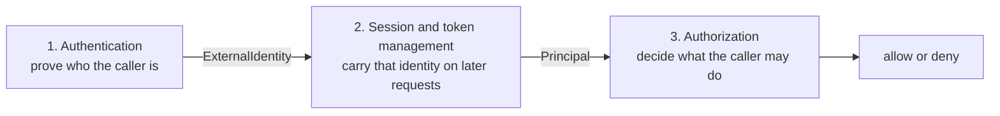
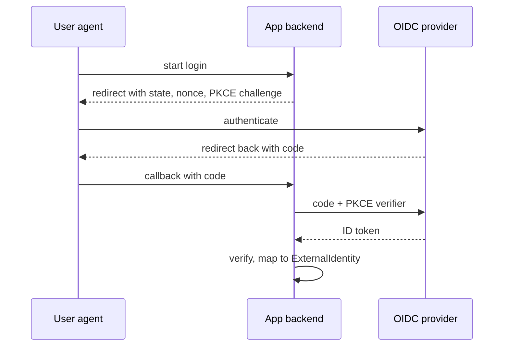

# E13 — Auth patterns

| | |
| --- | --- |
| **Epic** | [E13](index.md) |
| **Settled by** | [F13.1](F13.1-auth-design.md) |

A reference to the industry-standard authentication, session and token, and authorization patterns, written so the owner can review [the design](design.md) against the field. It describes the patterns and their trade-offs, then marks each one's status in this design. Nothing here is decided: the layer model is an [open question](F13.1-auth-design.md#open-questions), and a status of "supported" means the design proposes it.

[Back to E13](index.md)

Status vocabulary used in the tables:

| Status | Meaning |
| --- | --- |
| Adapter | The design proposes a pykit adapter for it. |
| Via broker | The app speaks OIDC to a broker, and the broker handles it. |
| Custom | Possible through a custom authenticator or provider; pykit ships nothing. |
| Out of scope | Not in this design. |
| Open | A question for the owner. |

## The three layers

Auth is three separate jobs. Treating them separately is what lets an app mix, for example, SAML login with cookie sessions and a policy-engine check.

| Layer | Input | Output | Contract in design.md | Example choices |
| --- | --- | --- | --- | --- |
| Authentication | Credentials, or a protocol response | `ExternalIdentity`: issuer, subject, claims, `auth_time`, `amr`, `session_ref` | `IdentityProvider`, then `AccountResolver` ([Contracts](design.md#contracts)) | OIDC, SAML, social login, passwords, passkeys, client credentials |
| Session and token management | A proven identity (an account ID, or a client ID) | A verified caller identity on every later request, as a `Principal` | The framework session binding, and `Authenticator` for bearer tokens | Server session with a cookie, JWT access token, opaque token, refresh token |
| Authorization | `Principal`, an action, a resource | Allow or deny; a filtered query | `AuthorizationContextProvider`, `Requirement`, `ResourcePolicy` | RBAC, ABAC, ReBAC, ACLs, policy engines |

Each layer meets the next through one contract. An authentication method never needs to know how the identity will travel, and an authorization model never needs to know how the caller authenticated. The few legitimate exceptions are listed under [Independence rules](#independence-rules).

Common confusions:

- **OAuth 2.0 is delegated authorization, not authentication.** An access token says a client may call an API on someone's behalf. It does not say who is at the keyboard. OpenID Connect adds the ID token and the login semantics.
- **A scope is not a permission.** A scope limits what a token may do. A permission is what the application grants a user. A delegated call is allowed only when both agree.
- **JWT is a token format, not a session strategy.** A JWT can be an access token, an ID token or a logout token. Whether it is the thing a browser holds across requests is a separate choice.
- **SSO is an outcome, not a protocol.** The user signs in once and reaches several apps. OIDC and SAML are the two common protocols that deliver it.
- **Authentication is not account lookup.** Proving a subject at an IdP does not say which application account it maps to. That is [account resolution](design.md#account-linking).

## Authentication patterns

### OpenID Connect: authorization code with PKCE

- **What:** OIDC Core 1.0 layers an identity protocol over OAuth 2.0 ([RFC 6749](https://www.rfc-editor.org/rfc/rfc6749)). The app (relying party) sends the user to the provider and gets back a signed ID token.
- **Flow:** redirect with `state`, `nonce` and a PKCE challenge ([RFC 7636](https://www.rfc-editor.org/rfc/rfc7636)); user authenticates at the provider; redirect back with a code; the backend exchanges the code at the token endpoint; it verifies the ID token (signature from the provider's JWKS, `iss`, `aud`, `exp`, `nonce`); optionally it calls `userinfo`.
- **Use when:** the provider speaks OIDC. This is the default choice for new work.
- **Pitfalls:** skipping `state` or `nonce` checks; accepting an ID token without checking `aud`; the implicit and password grants (removed by [RFC 9700](https://www.rfc-editor.org/rfc/rfc9700), OAuth 2.0 Security Best Current Practice); open redirects through an unvalidated return URL; mix-up attacks, which the `iss` response parameter ([RFC 9207](https://www.rfc-editor.org/rfc/rfc9207)) closes.
- **Status:** Adapter. See [OIDC login](design.md#oidc-login-authorization-code-with-pkce).

### OAuth 2.0 social login without OIDC

- **What:** Some providers (GitHub is the usual example) issue an access token but no ID token. The app calls the provider's user endpoint with that token to learn who the user is.
- **Flow:** the same authorization code flow, then `GET` the provider's user API.
- **Use when:** the provider offers nothing better.
- **Pitfalls:** no signed identity assertion, so the identity is only as trustworthy as the TLS call to the provider; emails may be unverified or have to be fetched from a second endpoint; linking accounts on email is an account-takeover path.
- **Status:** Adapter ("OAuth 2.0 + userinfo" in [Deployment profiles](design.md#deployment-profiles)), or Via broker.

### SAML 2.0

- **What:** An XML-based protocol (OASIS SAML 2.0) common in enterprise SSO. The IdP posts a signed assertion to the app's Assertion Consumer Service.
- **SP-initiated flow:** the app sends an `AuthnRequest` with a fresh ID; the IdP authenticates the user and posts a `SAMLResponse` whose `InResponseTo` matches that ID. The app validates the signature, `Destination`, `Audience` and time conditions, and records the assertion ID to stop replay.
- **IdP-initiated flow:** the user starts from the IdP's portal and the IdP posts an unsolicited response. It has no `InResponseTo`, so the app cannot tell a response it asked for from one an attacker induced (login CSRF), and the replay cache becomes the only defense. Use it only when a customer insists, per provider.
- **Use when:** a customer or corporate IdP offers only SAML.
- **Pitfalls:** XML signature wrapping (use a maintained library, require signed assertions, strict mode); trusting `RelayState` as a URL; linking on email instead of a persistent NameID; certificate rollover.
- **Status:** Adapter, SP-initiated by default; IdP-initiated is opt-in per provider. See [SAML login](design.md#saml-login-sp-initiated-http-post-binding).

### The broker pattern

- **What:** One OIDC-speaking service (Keycloak, Entra ID, Auth0, Zitadel, Authentik, Okta) sits between the app and every upstream IdP. The app speaks one protocol; the broker speaks SAML, social, LDAP and others, and issues the tokens.
- **Use when:** more than one app or API, machine clients, native apps, or many customer IdPs.
- **Pitfalls:** one more service to run or pay for; the broker's claim shapes and logout behavior leak into the app unless mapped to `ExternalIdentity` at the edge.
- **Status:** Via broker. This is the "broker profile" of [Deployment profiles](design.md#deployment-profiles), recommended.

### Local passwords

- **What:** The app stores a password verifier and checks it at login.
- **Rules ([NIST SP 800-63B](https://pages.nist.gov/800-63-4/sp800-63b.html)):** length over complexity (at least 8, allow at least 64 characters); no composition rules and no periodic rotation; check candidates against a breached-password list; allow paste and password managers; store with a memory-hard hash such as argon2id; rate-limit per account and per client; do not reveal whether the account exists ([OWASP Password Storage and Authentication cheat sheets](https://cheatsheetseries.owasp.org/)).
- **Use when:** there is no IdP, or for break-glass administrator accounts.
- **Pitfalls:** every app becomes a credential store with a breach liability; recovery and enrollment flows are large attack surfaces.
- **Status:** Adapter (optional provider). Registration, reset and recovery are out of scope ([Goals and non-goals](design.md#goals-and-non-goals)).

### Passkeys and WebAuthn

- **What:** Public-key credentials bound to the origin ([W3C WebAuthn](https://www.w3.org/TR/webauthn-3/), FIDO2). The private key stays on the user's device or password manager; the server stores a public key and verifies a signed challenge.
- **Use when:** you want phishing-resistant login without passwords. NIST 800-63B lists such authenticators at the highest assurance.
- **Pitfalls:** enrollment, recovery and device-loss flows are the hard part, not verification; relying-party ID must match the origin.
- **Status:** Via broker (the IdP offers passkeys, the app sees a normal OIDC login). A local adapter is Open.

### Magic links and email one-time codes

- **What:** The app emails a single-use link or code; possession of the mailbox is the proof.
- **Use when:** low-risk consumer apps where passwords are unwanted.
- **Pitfalls:** security equals the mailbox's; link scanners consume single-use links; codes need attempt limits; the link must be bound to the browser that asked for it.
- **Status:** Out of scope for the first version; Open.

### Multi-factor and step-up authentication

- **What:** MFA combines factors (knowledge, possession, inherence). Step-up asks for a stronger or fresher authentication before a sensitive action.
- **How it is signaled:** OIDC carries `acr` (the assurance level reached), `amr` (the methods used, [RFC 8176](https://www.rfc-editor.org/rfc/rfc8176): `pwd`, `otp`, `hwk`, `mfa`) and `auth_time`. A relying party can request a level with `acr_values` and a freshness limit with `max_age`. [RFC 9470](https://www.rfc-editor.org/rfc/rfc9470) defines the same for OAuth APIs.
- **Pitfalls:** treating a claim as proof without checking `iss` and `aud`; checking MFA only at login and never at the sensitive action.
- **Status:** The IdP runs MFA. The design records `auth_time` and `amr` and defers the `Requirement` clause ([F13.1 open questions](F13.1-auth-design.md#open-questions)).

### Machine authentication

| Method | How it works | Notes | Status |
| --- | --- | --- | --- |
| Client credentials ([RFC 6749 §4.4](https://www.rfc-editor.org/rfc/rfc6749#section-4.4)) | The client authenticates to the token endpoint with a secret and gets an access token | Simplest standard option; the secret must be stored and rotated | Via broker |
| `private_key_jwt` ([RFC 7523](https://www.rfc-editor.org/rfc/rfc7523), OIDC Core §9) | The client signs a JWT assertion with its private key | No shared secret to leak | Via broker |
| Mutual TLS ([RFC 8705](https://www.rfc-editor.org/rfc/rfc8705)) | Client authenticates with a certificate; tokens can be bound to it | Needs PKI and TLS termination that passes the certificate | Via broker; verifying binding Open |
| API keys | A long random string the server looks up | Not a standard protocol; no expiry, scope or audience unless built in; store only a hash | Custom |

### Authentication comparison

| Pattern | Standard | Strength | Main cost | Status |
| --- | --- | --- | --- | --- |
| OIDC code + PKCE | OIDC Core, RFC 6749, RFC 7636 | Signed identity, mature libraries | Needs an OIDC provider | Adapter |
| OAuth 2.0 social login | RFC 6749 | Reaches providers without OIDC | Unsigned identity, email caveats | Adapter or broker |
| SAML 2.0 | OASIS SAML 2.0 | Universal in enterprise | XML signature risks, no native mobile story | Adapter or broker |
| Broker | OIDC upstream, any downstream | One protocol in the app | A service to run | Recommended profile |
| Local password | NIST 800-63B | No external dependency | Credential liability | Adapter, optional |
| Passkey | WebAuthn | Phishing-resistant | Enrollment and recovery | Via broker |
| Magic link | None | No password | Mailbox is the factor | Out of scope |
| Client credentials | RFC 6749 | Standard for services | Secret handling | Via broker |
| API key | None | Easy for integrators | Weak by default | Custom |

## Session and token patterns

After authentication, something must tell the server who is calling on each later request. The choice depends on who the caller is (a browser, a native app, a service) more than on how it logged in.

### Server-side session with a cookie

- **What:** The server stores session state and gives the browser an opaque ID in a cookie ([OWASP Session Management cheat sheet](https://cheatsheetseries.owasp.org/cheatsheets/Session_Management_Cheat_Sheet.html)).
- **Cookie attributes:** `HttpOnly` (script cannot read it), `Secure`, `SameSite=Lax` or `Strict`, `Path=/`, no `Domain` and the `__Host-` prefix (browsers then refuse a cookie set by a sibling subdomain), per [RFC 6265bis](https://datatracker.ietf.org/doc/draft-ietf-httpbis-rfc6265bis/).
- **Lifetime:** a new ID at login and on privilege change (stops fixation); an idle timeout and an absolute timeout; deletion on logout.
- **CSRF:** a cookie is sent automatically, so unsafe methods need a CSRF token or an `Origin` check ([OWASP CSRF cheat sheet](https://cheatsheetseries.owasp.org/cheatsheets/Cross-Site_Request_Forgery_Prevention_Cheat_Sheet.html)). `SameSite` helps but is not a replacement.
- **Use when:** the caller is a browser and the app has a backend.
- **Pitfalls:** signed-cookie sessions cannot be revoked; a shared parent domain widens the cookie's reach; a store outage logs everyone out.
- **Status:** Adapter. See [Sessions and cookies](design.md#sessions-and-cookies).

### Access tokens: self-contained JWT or opaque

| | JWT access token | Opaque token |
| --- | --- | --- |
| Standard | [RFC 9068](https://www.rfc-editor.org/rfc/rfc9068) profile of [RFC 7519](https://www.rfc-editor.org/rfc/rfc7519) | Any random string, validated by [RFC 7662](https://www.rfc-editor.org/rfc/rfc7662) introspection |
| Validation | Local: signature, `iss`, `aud`, `exp` | Call the authorization server for each token, or cache the answer |
| Revocation | Waits for expiry unless every API checks a deny list | Immediate at the authorization server |
| Content visible to holder | Yes, unless encrypted | No |
| Cost | Key rotation and JWKS caching; short lifetimes | A network call and a dependency on the authorization server |
| Pitfalls | Algorithm confusion, missing `aud` check ([RFC 8725](https://www.rfc-editor.org/rfc/rfc8725)); stale claims | Introspection latency and availability |
| Status | Adapter (`OidcAuthenticator`) | Open (optional authenticator) |

Bearer tokens ([RFC 6750](https://www.rfc-editor.org/rfc/rfc6750)) work for whoever holds them, so keep lifetimes short and never put them in URLs.

### Refresh tokens and rotation

- **What:** A long-lived credential that gets new short-lived access tokens without another login ([RFC 6749 §6](https://www.rfc-editor.org/rfc/rfc6749#section-6)).
- **Best practice ([RFC 9700](https://www.rfc-editor.org/rfc/rfc9700)):** public clients get sender-constrained or rotating refresh tokens, and reuse of a rotated token revokes the whole family.
- **Pitfalls:** a refresh token held in a browser is the most valuable thing script can steal; rotation races between tabs.
- **Status:** Out of scope. A BFF keeps upstream tokens on the server and discards them by default ([OIDC login](design.md#oidc-login-authorization-code-with-pkce)). Native apps and machine clients manage refresh tokens with the broker.

### Sender-constrained tokens

- **What:** A token bound to a key the client holds, so a stolen token is useless without the key. DPoP ([RFC 9449](https://www.rfc-editor.org/rfc/rfc9449)) signs each request with a client key. Mutual TLS binding ([RFC 8705](https://www.rfc-editor.org/rfc/rfc8705)) ties the token to a client certificate.
- **Use when:** tokens must live in an environment that can leak them (a browser client, a mobile app) or the data is high value.
- **Pitfalls:** support is needed at the authorization server and in every API; key storage in a browser is itself exposed to script.
- **Status:** Out of scope; Open.

### Browser options

[OAuth 2.0 for Browser-Based Applications](https://datatracker.ietf.org/doc/draft-ietf-oauth-browser-based-apps/) names three architectures and ranks them by security.

| Architecture | Who holds tokens | Cross-site-scripting exposure | Needs a backend of its own |
| --- | --- | --- | --- |
| Backend for frontend (BFF) | The backend; the browser has a session cookie | Script can make calls as the user while the page is open, but cannot take a token away | Yes |
| Token-mediating backend | The backend runs the flow, then hands the SPA an access token | Script can read the token from memory | Yes |
| Browser-based OAuth client | The SPA holds access and refresh tokens | Script can read tokens, or run its own silent authorization request | No |

The IETF ranks the BFF first for apps that have a backend, since moving tokens out of reach of script removes the largest class of theft. A browser-based client remains right when there is no backend of the app's own. [Why the browser holds a session](design.md#why-the-browser-holds-a-session-and-not-a-token) and [the browser-client alternative](design.md#the-browser-client-alternative) apply this.

Status: BFF is the design's choice; the other two are [Considered and rejected](design.md#considered-and-rejected) or a secondary profile ([open questions](F13.1-auth-design.md#open-questions)).

### Token exchange for downstream calls

- **What:** A service swaps the token it received for a new token for another audience ([RFC 8693](https://www.rfc-editor.org/rfc/rfc8693)). The result can keep the original user (delegation) or act as the service (impersonation, discouraged).
- **Alternatives:** call downstream with the service's own client-credentials token (no user identity), or forward the user's token (breaks audience restriction, so avoid).
- **Status:** Via broker; Open in the design ([Machine clients](design.md#machine-clients-and-downstream-services)).

### Revocation and logout

| Mechanism | What it does | Caveat | Status |
| --- | --- | --- | --- |
| Delete the server session | Ends local access at once | Does not end the IdP session | Adapter |
| OIDC RP-initiated logout | The app redirects to the provider's end-session endpoint | The user may be signed out of other apps too | Adapter, optional per provider |
| OIDC back-channel logout | The provider posts a signed `logout_token` carrying `sub` or `sid` | Needs the session store to be searchable by `sid` | Adapter |
| SAML Single Logout | Logout request and response between SP and IdP | Unreliable across IdPs; local timeouts do the real work | Adapter, optional |
| Token revocation ([RFC 7009](https://www.rfc-editor.org/rfc/rfc7009)) | The client asks the authorization server to revoke a token | JWTs still verify locally until expiry | Via broker |

### Session and token comparison

| Pattern | Caller | Revocable at once | Server state | CSRF risk | Status |
| --- | --- | --- | --- | --- | --- |
| Server session cookie | Browser | Yes | Session store | Yes | Adapter |
| JWT access token | Service, native app | No, until expiry | None | No | Adapter |
| Opaque token + introspection | Service, native app | Yes | Authorization server | No | Open |
| Refresh token | Native app, service | At the authorization server | Authorization server | No | Out of scope |
| Sender-constrained token | High-value API | As above | Key at the client | No | Out of scope |

## Authorization patterns

### Where decisions happen

- **Route level (coarse):** may this caller reach this endpoint at all? A declarative check on permission, role or scope. Cheap, and it rejects early with 403.
- **Resource level (fine):** may this caller act on this record, and which records may they list? This needs the record, so it runs after loading it, or as a query filter.
- **Query scoping:** a list endpoint adds the caller's scope to the query. Filtering rows after fetching leaks existence through counts and breaks pagination ([OWASP Authorization cheat sheet](https://cheatsheetseries.owasp.org/cheatsheets/Authorization_Cheat_Sheet.html)). Broken object-level authorization is the first item of the OWASP API Security Top 10.
- **Deny by default**, and return 404 instead of 403 when the existence of a record is itself sensitive.
- **Status:** `Requirement` for routes; `ResourcePolicy.allows` and `ResourcePolicy.scope` for records ([Authenticated request](design.md#authenticated-request-and-authorization)).

### Models

| Model | Decides by | Strength | Weakness | Status |
| --- | --- | --- | --- | --- |
| ACL | A list on each resource of who may do what | Direct and easy to explain | Does not scale across many resources; hard to audit globally | Custom in `ResourcePolicy` |
| RBAC ([NIST RBAC](https://csrc.nist.gov/projects/role-based-access-control), ANSI INCITS 359) | The caller's roles, mapped to permissions | Simple, auditable | Role explosion; no per-record rules | Adapter (permissions and roles) |
| ABAC ([NIST SP 800-162](https://csrc.nist.gov/pubs/sp/800/162/upd2/final)) | Attributes of caller, resource, action and environment | Expresses tenant, ownership, time | Rules scatter through code unless centralized | Adapter through `ResourcePolicy` and context attributes |
| ReBAC | Relationships in a graph: "editor of a folder that contains this document" | Natural for sharing and hierarchies; Google's Zanzibar model, OpenFGA | Needs a relationship store kept in sync | Out of scope; Open |
| OAuth scopes | What the resource owner delegated to a client | A ceiling on a token | Not a user's permission | Limit on bearer principals |

Scopes are a ceiling: a delegated call is allowed only when the user's permissions and the token's scopes both permit it.

### Where the data comes from

- **IdP claims and groups** are a snapshot taken at login. They are good for coarse facts such as employment and group membership, and they go stale between logins.
- **App-owned entitlements** (roles, tenancy, org structure, ownership) live in the application's database and change independently of the IdP.
- **Where the decision data sits:** putting permissions in a token freezes them until expiry and grows every request. The design computes the authorization context per request from current data, behind a versioned cache ([Authorization model](design.md#authorization-model), [Authorization changes](design.md#authorization-changes)).

### Policy engines and the PDP/PEP split

- **Split ([NIST SP 800-162](https://csrc.nist.gov/pubs/sp/800/162/upd2/final), XACML):** a policy enforcement point (PEP) intercepts the request and asks a policy decision point (PDP) for allow or deny. The PDP evaluates policy over attributes from a policy information point.
- **Engines:** OPA (Rego, general purpose), Cedar (AWS, analyzable policy language), OpenFGA (ReBAC). They move the rules out of application code and give one audit surface, at the cost of an extra component and a data-sync problem.
- **In the design:** `Requirement` and `ResourcePolicy` are the PEP seam. An engine would sit behind `ResourcePolicy` as a PDP. No engine integration is in the design ([Goals and non-goals](design.md#goals-and-non-goals)).

### UI mirroring

The UI needs to know what to show. It reads the user's effective permissions from the server and hides features, but never decides: the server rechecks every request. A stale UI fails safely with 403, and the client refetches. Status: `/auth/session` ([HTTP surface](design.md#http-surface)).

### Authorization comparison

| Pattern | Best for | Ceiling | Status |
| --- | --- | --- | --- |
| Route-level requirement | Endpoint access | Cannot see the record | Adapter |
| Resource policy + query scope | Record-level rules, tenancy, ownership | Rules live in app code | Adapter |
| RBAC | Line-of-business apps | Role explosion | Adapter |
| ABAC | Tenant and ownership rules | Needs discipline to centralize | Adapter |
| ReBAC | Sharing, nested resources | Relationship store | Out of scope |
| External engine | Many services, shared audit | Extra component | Out of scope |

## Mix and match

| Landscape | Authentication | Session and token | Authorization |
| --- | --- | --- | --- |
| Internal tool behind corporate SSO | OIDC (or SAML) direct to the corporate IdP | Server session cookie | RBAC from IdP groups mapped to roles, plus a few resource rules |
| B2C app with social login | OIDC and OAuth 2.0 social, optional passkeys through a broker; no local passwords if avoidable | Server session cookie | RBAC for staff; ownership rules through `ResourcePolicy` for user data |
| B2B multi-tenant SaaS, per-customer SAML or OIDC | Broker that holds each customer's connection; link on (issuer, subject) | Server session for the web UI; bearer tokens for the customers' API clients | Tenant as an attribute, enforced in `ResourcePolicy.scope`; RBAC within a tenant |
| API-only service for machine clients | Client credentials or `private_key_jwt` at a broker | JWT access tokens (RFC 9068), short-lived; opaque with introspection when immediate revocation matters | Scopes as the ceiling; service-account roles |
| SPA, mobile app and several APIs | Broker for all; code + PKCE in the system browser for native ([RFC 8252](https://www.rfc-editor.org/rfc/rfc8252)) | BFF cookie for the SPA; bearer tokens for mobile and between APIs; token exchange for downstream | Shared permission catalog; each API enforces its own |
| Regulated or high-assurance app | Broker with phishing-resistant MFA (passkeys, `hwk`); `acr` and `max_age` for sensitive actions | Server session with short idle timeout; sender-constrained tokens for APIs | ABAC with central policy; consider an external engine for audit; full audit log of decisions |

### Independence rules

- **AuthN knows nothing about carriage or AuthZ.** An adapter ends in `ExternalIdentity`. It does not decide session length, cookie format or permissions.
- **Carriage knows nothing about protocols.** It stores an account or client ID and authentication metadata. It does not hold permissions or protocol artifacts such as assertions.
- **AuthZ knows nothing about how the caller authenticated.** It reads `Principal`, never an IdP response, a cookie or a token.
- **Legitimate couplings, carried as data:**
  - Step-up needs `auth_time` and `amr` to flow from authentication through the session onto the `Principal`, so authorization can require a fresh or multi-factor login.
  - Logout needs `session_ref` (`sid` or `SessionIndex`) to flow from authentication into the session store.
  - Delegated tokens need scopes on the `Principal` so authorization can apply the ceiling.
  - Account resolution at login writes IdP attributes that the authorization context later reads.

Swapping any one layer should change only that layer's adapter and configuration.

## Where this design sits

| Catalog entry | Position in design.md |
| --- | --- |
| OIDC, SAML, OAuth 2.0 social, local, development providers | Adapters behind `IdentityProvider` ([Contracts](design.md#contracts)) |
| Broker | Recommended profile, with direct federation as first-class ([Deployment profiles](design.md#deployment-profiles)) |
| Account linking | On (issuer, subject); email only when verified and authoritative ([Account linking](design.md#account-linking)) |
| Browser carriage | BFF with a server session ([Sessions and cookies](design.md#sessions-and-cookies)) |
| Machine carriage | Bearer JWTs from an authorization server, verified by `OidcAuthenticator`; pykit never mints tokens ([Machine clients](design.md#machine-clients-and-downstream-services)) |
| Logout | RP-initiated, back-channel and optional SAML SLO ([Logout](design.md#logout)) |
| Authorization | Permissions as the unit, RBAC with ABAC through `ResourcePolicy`, computed per request ([Authorization model](design.md#authorization-model)) |
| Passkeys, magic links, API keys, opaque tokens, refresh tokens, DPoP, ReBAC, policy engines | Positions proposed in [Goals and non-goals](design.md#goals-and-non-goals), [Machine clients](design.md#machine-clients-and-downstream-services) and [Authorization model](design.md#authorization-model) |
| The three-layer split | [Layers](design.md#layers); the choice is an [open question](F13.1-auth-design.md#open-questions) |
