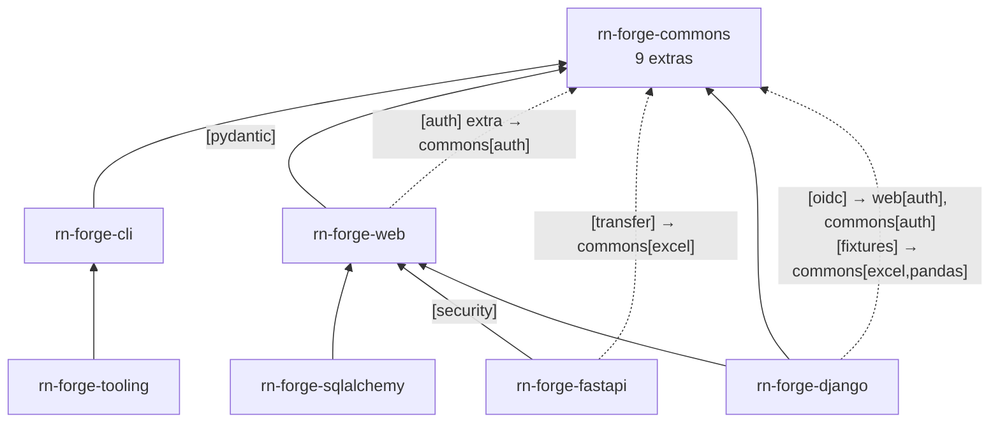
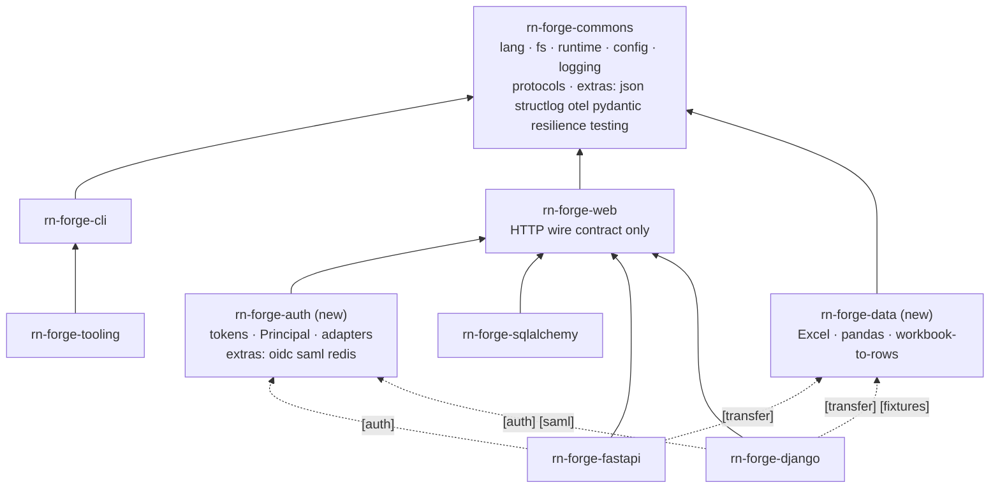
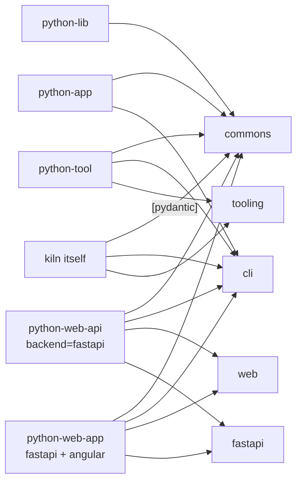

# E15 — Package boundaries design

|  |  |
| -- | -- |
| **Epic** | [E15](index.md) |
| **Settled by** | [F15.1](F15.1-package-boundary-rule.md) |
| **Depends on** | [ADR-0002](../../../adr/ADR-0002.md), [ADR-0003](../../../adr/ADR-0003.md), [ADR-0004](../../../adr/ADR-0004.md), [ADR-0011](../../../adr/ADR-0011.md) |

Which parts of `rn-forge-commons` earn their own package, the one structure
every such package uses for its adapters, what moves into `rn-forge-auth` and
`rn-forge-data`, and which framework-neutral areas of `rn-forge-django` wait for
a trigger. [ADR-0011](../../../adr/ADR-0011.md) accepts the rule and the adapter
structure, and the owner answered the open questions on 2026-10-15.

[Back to E15](index.md)

## Problem

The problem in `rn-forge-commons` is its extras plumbing and its cohesion, not
its install size.

- **Base install.** Five small libraries: `ruamel.yaml`, `tomlkit`,
  `verboselogs`, `rich` and `dacite`. Importing `rn_forge.commons`, its
  logging or its config loads none of the optional libraries (verified).
- **Nine extras.** `auth`, `json`, `structlog`, `resilience`, `excel`, `otel`,
  `pandas`, `pydantic` and `testing`, plus `all`.
- **Who asks for them.** Only pykit's own packages and kiln, which uses
  `rn-forge-commons[pydantic]`. No kiln golden depends on a commons extra.

The plumbing between pykit's framework packages is where it breaks down.

| Commons extra | Requested by | Note |
| -- | -- | -- |
| `pydantic` | `rn-forge-web` (base), kiln | Web needs it for every install. |
| `auth` | `rn-forge-web[auth]`, `rn-forge-django[oidc]`, then `rn-forge-fastapi[oidc]` through web | A chain three hops long. E13 replaces it. |
| `excel` | `rn-forge-fastapi[transfer]`, `rn-forge-django[fixtures]` | `rn_forge.django.drf.transfer` imports `rn_forge.commons.data.excel.write_xlsx`, but django's `transfer` extra does not declare `rn-forge-commons[excel]`. It works only because `django-import-export[xlsx]` brings openpyxl. `rn_forge.fastapi.transfer` imports the same `write_xlsx` and does declare `rn-forge-commons[excel]`. |
| `pandas` | `rn-forge-django[fixtures]` | The heaviest dependency set in the workspace (pandas and numpy). |
| `resilience` | nobody | No import in pykit or kiln. |
| `json`, `structlog`, `otel` | applications | Logging back ends. They belong with logging. |
| `testing` | test suites | A dev-time extra. |

## Commons, module by module

Line counts come from `wc -l` on `packages/rn-forge-commons/src`. Consumers come
from searching every package's `src` for imports, plus kiln's `src`.

| Area | Lines | Third-party | Used by | Verdict |
| -- | -- | -- | -- | -- |
| `lang`, `fs`, `runtime`, `config`, `exceptions`, `findings` | about 5,300 | base only | cli, tooling, django, web, kiln | Keep. |
| `logging` and the `json`, `structlog`, `otel` extras | 1,280 | optional back ends | every package | Keep. |
| `lang/models` (`pydantic` extra) | 146 | pydantic | web, kiln | Keep. |
| `testing` | 143 | assertpy, pytest | test suites | Keep. |
| `integration/messaging`, `objects`, `secrets` | 279 | none | django (messaging) | Keep as dependency-free protocols. |
| `integration/resilience` | 316 | httpx, purgatory, stamina | nobody | Keep as an extra until it has a consumer. |
| `integration/auth` | 277 | pyjwt[crypto] | web, django | Move to `rn-forge-auth`. |
| `data/excel`, `data/pandas` | 675 | openpyxl, tablib, pandas | django transfer and fixtures, fastapi transfer | Move to `rn-forge-data`. |

## The rule

[ADR-0011](../../../adr/ADR-0011.md) records the decision. A part becomes a
package only when it passes all three tests:

1. A distinct dependency set, heavy or security-sensitive enough that a consumer
   should choose it on purpose.
1. A consumer today, not an expected one.
1. One audience: the people who install it want all of it, so it needs few or no
   extras of its own.

Every package has a fixed cost here: a tag and a pin
([ADR-0004](../../../adr/ADR-0004.md)), a CI verify job, a MkDocs site, a
changelog and a slot in the release batch, a pin bump in every consumer on each
release, and an entry in kiln's archetype allowed lists and its `rn-forge-deps`
check. A part that fails any test stays in commons, behind an extra if it has
dependencies.

## Adapter structure

A new package is useful only if the next adapter does not force a refactor.
Every package that integrates with external systems takes one shape.

- **The core** holds protocols, data types and neutral logic. It has no
  third-party dependency beyond its rn-forge base.
- **Each adapter** is its own module or subpackage, `rn_forge.<pkg>.<adapter>`,
  behind an extra named after it. The core never imports an adapter. An
  `.importlinter` forbidden contract per package enforces it. Adapters import
  the core.
- **The facade.** The curated `__init__` re-exports the core only. Adapter
  modules are imported directly ([ADR-0003](../../../adr/ADR-0003.md)).
- **Framework packages** (`rn-forge-django`, `rn-forge-fastapi`,
  `rn-forge-sqlalchemy`) bind a package through their own extra, which names
  `rn-forge-<pkg>[<adapter>]`. They never list commons extras.
- **Adding an adapter** is a new module, a new extra, a docs page and tests. The
  core's public API does not change.

| Package | Core | Adapters (extra) |
| -- | -- | -- |
| `rn-forge-auth` | `Principal`, `Requirement`, the authentication and authorization protocols, the session store protocol, an in-memory store | `oidc` (PyJWT now; Authlib arrives with E13), later `saml` (python3-saml) and `redis` (a session store) |
| `rn-forge-data` | Workbook and row types, validation, `ColumnType` conversion | `pandas` |
| A future messaging core | Outbox and inbox store protocols, the relay and consumer loops | `django` and `sqlalchemy` stores |

A package with a single adapter still follows the shape. The first adapter is
where the shape is cheapest to get right.

## Today's map and target map

Solid lines are base dependencies. Dashed lines are dependencies an extra adds.
Every dashed line is something a framework package's maintainer has to keep in
sync.

Framework packages then name a package instead of a list of commons extras.
Commons drops from nine extras to six, and loses its two heaviest dependency
sets: pandas and the crypto and JWT stack. `rn-forge-auth` depends on
`rn-forge-web`, following
[E13's package placement](../E13-auth/design.md#package-placement).

The extra names in the target map are illustrative.
[F13.2](../E13-auth/F13.2-auth-package.md) and [F15.3](F15.3-data-package.md)
settle them.

## rn-forge-auth contents

[E13's package placement](../E13-auth/design.md#package-placement) decides why
auth is a separate package. This section lists what E13's F13.2 moves. Of the
commons token code, F13.2 moves only what E13's
[library evaluation](../E13-auth/design.md#library-evaluation) keeps, and
deletes the rest.

| From | Moves to `rn-forge-auth` |
| -- | -- |
| `rn_forge.commons.integration.auth` (277 lines) | `JwtVerifier`, `JwksCache`, `discover_oidc`, `fetch_json` |
| `rn_forge.web.auth` | `Principal`, `Requirement`, `Authenticator`, `AsyncAuthenticator`, `Authorizer`, `ScopeAuthorizer`, `principal_from_claims` |
| `rn_forge.web.oidc` | `OidcAuthenticator` |

`rn-forge-web` keeps the wire contract: `Credentials`, `parse_authorization`,
`challenge_header`, `AUTH_FAILED_DETAIL`, `AuthenticationFailed`,
`PermissionDenied` and the problem responses.

Package wiring after the move:

- `rn-forge-auth` depends on `rn-forge-web`, which depends on `rn-forge-commons`
  (auth, then web, then commons).
- Commons loses its `auth` extra. Web loses its `auth` extra.
- Django's `oidc` extra and FastAPI's `oidc` extra repoint to `rn-forge-auth`.
- Django's `jwt` extra and the simplejwt flows are removed by E13, not E15.

## rn-forge-data contents

| From | Moves to `rn-forge-data` |
| -- | -- |
| `rn_forge.commons.data.excel` (527 lines; openpyxl, tablib) | `ExcelAdapter`, `write_xlsx` and the workbook helpers |
| `rn_forge.commons.data.pandas` (148 lines; pandas) | `PandasUtils` |
| `rn_forge.commons.lang.types` | The pandas aliases: the guarded `pandas` import, `SeriesRow`, `series_value` and `series_columns` |

Proposed shape: base dependencies are `openpyxl` and `tablib[xlsx]`, and a
`pandas` extra holds pandas. `ExcelAdapter` converts between workbooks and
DataFrames, so it lives in the `rn_forge.data.pandas` adapter with
`PandasUtils`, and the core never imports pandas.

Commons loses its `excel` and `pandas` extras, which takes it from nine extras
to six: `json`, `structlog`, `otel`, `pydantic`, `resilience` and `testing`. The
root development group's `rn-forge-commons[excel]` entry is replaced.

Callers to repoint (a search of every package's `src` finds no other import of
`data.excel` or `data.pandas`, and no commons module imports them):

| Caller | Imports | Extra after the move |
| -- | -- | -- |
| `rn_forge.django.drf.transfer` | `write_xlsx` | `transfer` names `rn-forge-data`. This fixes the undeclared openpyxl dependency. |
| `rn_forge.django.fixtures` | `ExcelAdapter`, `PandasUtils` | `fixtures` names `rn-forge-data[pandas]`. |
| `rn_forge.fastapi.transfer` | `write_xlsx` | `transfer` names `rn-forge-data`. |

## What a new package needs in this workspace

[Adding a package](../../../runbooks/adding-a-package.md) is the procedure. For
`rn-forge-<x>`:

- `packages/rn-forge-<x>/` with a `pyproject.toml` that pins internal
  dependencies to direct-URL tags ([ADR-0004](../../../adr/ADR-0004.md)), a
  `README.md`, a `CHANGELOG.md`, `docs/` and a standalone strict `mkdocs.yml`.
- `src/rn_forge/<x>/__init__.py`, the curated facade, and a `py.typed` marker.
- `tests/` mirroring the source layout, with no `__init__.py`.
- The root `pyproject.toml`: a `[tool.uv.workspace].members` entry, the root
  development group and local `[tool.uv.sources]`. Pyright already includes
  `packages`, so it needs no edit.
- `.importlinter`: add the package to `root_packages` and to the `web-layers`
  contract, plus its forbidden contract that the core never imports an
  adapter.
- The combined site: a nav entry in the root `mkdocs.yml`, the package's source
  path under `mkdocstrings`, and its row in `docs/index.md`.
- The root `README.md` package table, `docs/architecture/workspace.md` and
  `docs/guides/choosing-packages.md`.
- CI: [F14.1](../E14-workspace-automation/F14.1-discovered-pipeline.md) plans
  jobs from the workspace manifests, so the workflow needs no edit. A
  `[tool.workspace-ci.smoke]` table is needed for any extra that needs an
  isolated install check, as `rn-forge-django` has. Neither new package needs
  a PostgreSQL table.
- The first version is `0.1.0`, tagged `rn-forge-<x>-v0.1.0`.

## Consumers

What each kiln golden installs, from `uv export --no-dev --frozen` in each
golden:

| Golden | rn-forge packages | Runtime closure | Third-party it brings |
| -- | -- | -- | -- |
| `python-lib` | commons (required); tooling allowed | — | The golden's own members declare none; a real library gets the commons base. |
| `python-app` | commons, cli | 14 | rich, typer, ruamel-yaml, tomlkit, dacite, verboselogs and their transitive dependencies |
| `python-tool` | commons, cli, tooling | 16 | Adds jinja2 and markupsafe |
| `python-web-api` (fastapi) | commons, cli, web, fastapi | 37 | Adds fastapi, starlette, anyio, pydantic, secure, six OpenTelemetry packages and wrapt |
| `python-web-app` (fastapi and angular) | same as `python-web-api` | 37 | Same backend; the frontend is pnpm |

Kiln builds the allowed rn-forge set from the archetype's list, the chosen
backend framework and, for lifecycle, tooling
(`src/rn_forge/kiln/archetypes/__init__.py`, lines 117 to 124). The goldens are
unaffected by today's commons extras and stay unaffected after the split. A web
golden picks up `rn-forge-auth` when it turns auth on and `rn-forge-data` when
it turns import and export on. Kiln's composed allowed set is where those
choices are expressed.

Kiln follow-ups belong to kiln's own backlog and, per
[ADR-0008](../../../adr/ADR-0008.md), do not gate pykit:

- Allow `rn-forge-auth` and `rn-forge-data` in the web archetypes' composition
  when a project turns auth or import and export on.
- Update kiln's `standard.md.j2` package description.

The goldens pin pykit to `@main`, not to the release tags that
[ADR-0004](../../../adr/ADR-0004.md) describes. That is fine for goldens that
track the pykit branch under test, but generated repositories need tags.

## Framework-neutral areas still in rn-forge-django

The real axis is the ORM, not the web framework. FastAPI has no ORM, and a
FastAPI application's persistence is `rn-forge-sqlalchemy` (async). None of
these areas belongs in `rn-forge-web`, which is the HTTP wire contract.

### Celery

`rn_forge.django.celery` is 43 lines. `RETRYABLE_TASK_KWARGS` is already
neutral. `make_app` is Django-specific only in its default
`config_source="django.conf:settings"` and its argument-less
`autodiscover_tasks()`. It could move to commons behind a `celery` extra, with a
FastAPI application passing its own config object and task packages. Feature:
[F15.7](F15.7-neutral-celery.md).

### Messaging

`rn_forge.django.messaging` is 251 lines: abstract outbox and inbox models,
`make_outbox_relay`, `process_event` and `UnknownMessageType`.

- **Neutral already, in commons:** `MessageBus`, `AsyncMessageBus`,
  `HandlerRegistry` and `InMemoryMessageBus`.
- **Could become neutral:** the relay loop (claim a batch, publish, mark, report
  lag, log), the consumer loop (dedupe, dispatch, record, re-raise),
  `UnknownMessageType` and the field vocabulary.
- **ORM-bound:** the models, `select_for_update(skip_locked=True)`,
  `transaction.atomic` and the database router.

Splitting needs `OutboxStore` and `InboxStore` protocols whose stores supply a
transaction scope, because the consumer must run the handler and record the
processed marker in one transaction. `rn-forge-sqlalchemy` would also need async
variants. Feature: [F15.5](F15.5-neutral-messaging.md).

### Fixtures

`rn_forge.django.fixtures` is 266 lines. The neutral half is workbook reading,
sheet and column validation, and the `ColumnType` enum with the conversions it
selects, which already call `PandasUtils`. That half belongs in `rn-forge-data`.
The Django half is the `loaddata` JSON output (`"app.model"`, `pk`, `fields`,
foreign keys as natural keys) and `load_data` (`django.setup` plus `loaddata`).
A SQLAlchemy loader needs natural-key rules that both ORMs share, which is the
[model-vocabulary](../../ideas.md#model-vocabulary) idea. Feature:
[F15.6](F15.6-neutral-fixtures.md).

### Decision

All three stay in `rn-forge-django` now. Each splits into a neutral core and ORM
bindings when its trigger fires. Moving messaging now is rejected because only
one binding exists to design against.

## Non-web consumers of the ORM packages

Real scenarios exist where the ORM packages run with no web server: a Celery
worker, an outbox relay process, fixture loading, an admin or data-migration
command, an ETL or batch job and a desktop SQLite tool. Django can also run
standalone through `settings.configure()` or `DJANGO_SETTINGS_MODULE` and
`django.setup()`.

Facts:

- `rn-forge-django`'s base dependencies include `rn-forge-web`, which brings
  pydantic and `opentelemetry-api`.
- The only model-layer import of web is `rn_forge.django.models.concurrency`
  (`VersionConflict`, `DomainConflict`), so importing `rn_forge.django.models`
  loads `rn_forge.web`. Every other web use in django is HTTP-facing: `drf/*`,
  `views.py`, `exceptions.py`, `cors.py`, `security.py` and `auth/drf/*`.
- `rn-forge-sqlalchemy`'s `concurrency.py` imports `VersionConflict`, which is a
  domain error. Its `pagination.py` uses web's page token, which is
  legitimately HTTP.

The cost today is two small extra installs and an import. Nothing is
functionally broken. The clean shape moves `VersionConflict` and
`DomainConflict` to commons as domain errors, with web keeping the mapping to
409 problems. Making web an extra of `rn-forge-django` is a further option; it
is breaking, and ADR-0002 forbids aliases. Both are deferred as
[F15.4](F15.4-domain-errors.md). If E13's placement work moves domain types out
of web, these two belong in the same move.

## Considered and rejected

- **`rn-forge-logging`.** Every package uses it, so it would be one more
  required dependency with no choice involved. Its back ends are already
  extras.
- **`rn-forge-integration` or `rn-forge-resilience`.** Nothing in pykit or kiln
  consumes resilience, and the protocols have no dependencies. A package would
  carry a tag and a pin for zero users.
- **`rn-forge-messaging` now.** The only implementation is Django's. Wait for
  the SQLAlchemy trigger, so the neutral core is designed against two real
  bindings.
- **`rn-forge-fs`, `rn-forge-lang`, `rn-forge-runtime`.** These are the
  foundation every package uses together. Splitting them multiplies pins
  without letting anyone install less.
- **`rn-forge-tabular` as the name for the data package.** The owner chose
  `rn-forge-data` on 2026-10-13.

## Answered questions

The owner answered these on 2026-10-15, in
[S15.1.1](F15.1-package-boundary-rule.md).

- **`rn-forge-data` base dependencies or extras?** openpyxl and tablib in the
  base, pandas behind the `pandas` extra. Excel is the package's purpose and
  pandas is heavy. If the package grows into data-science utilities, pandas
  can move into the base in a later breaking release.
- **Is `rn-forge-auth`'s JWT verification core or the `oidc` extra?** The `oidc`
  extra, so the core stays dependency-free and follows the adapter structure.
- **Order of F13.2 and E13's adapter features.** F13.2 first, after
  [F13.1](../E13-auth/F13.1-auth-design.md) settles placement, so the adapters
  are written inside the package.
- **Does F15.4 join release 6 if E13 already reshapes web?** Yes in that case,
  as one move. Otherwise it stays deferred.
- **Package versions.** `0.1.0` for the new packages, and breaking bumps for
  commons, web, django and fastapi.
